<!--
  Style: black, white and greys; square frames; Inter + DejaVu Sans Mono.
  Graphics: python tools/make_mono.py (banner, stack), python tools/make_titles.py (section title bars)
  Videos: a bare https://github.com/user-attachments/assets/<id> URL on its own
  line (blank line above and below) renders as GitHub's video player.
-->

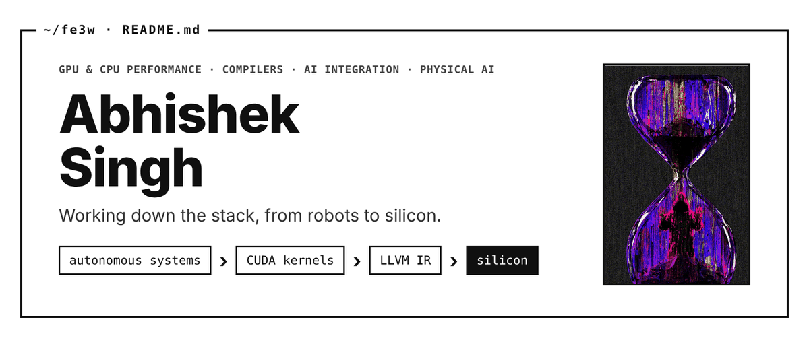

Pune, IN · B.Tech, class of 2027 · Honors in Embedded Systems · DD Robocon 2026 National Finalist · open to compiler and performance or FDE/SDE internships

## Projects

### 01 · [GPU & CPU Performance Optimization for AI Workloads , Confrence paper & Project](#performance)
CUDA · Tensor Cores · NVIDIA Nsight · Intel VTune · OpenMP · AVX2

### 02 · [Vision-Language-Action (VLA) Pipeline & Vision-Language Model Fine-Tuning for Robotics](#autonomy)
vision-language models · LoRA fine-tuning · model distillation · inference optimization · NVIDIA Isaac Sim

### 03 · [Systolic-Array GEMM Hardware Accelerator](#accelerator)
SystemVerilog · simulation · FPGA · ASIC

### 04 · [AI Research Agent & Voice-Activated Notes, Running on Local LLMs](#voice-notes)
Ollama · local LLMs · AI agent orchestration · human-in-the-loop · Google OAuth · cloud API integration · end-to-end encryption

### 05 · [LLVM 20 Loop Vectorization Analyzer](#compilers)
C++ · LLVM 20 · compilers · GCC

### 06 · [Design Lead & Team Co-Head · DD Robocon 2026 National Finals](#leadership)
national-level robotics competition · team coordination · dispute resolution · recruitment and mentoring · CAD design and integration

### 07 · [Robotics Builds: Computer Vision, ROS 2 & CAD](#builds)
OpenCV · ROS 2 · Gazebo · CAD design (SolidWorks) · ESP32 · MQTT

### [About Me](#whoami) · [Skills](#stack) · [Contact](#contact)

**Email:** abhishekp135531@gmail.com · [LinkedIn](https://www.linkedin.com/in/abhishek-singh-a2003b287/) · [GitHub](https://github.com/Fe3w)

---

<picture>
  <source media="(prefers-color-scheme: dark)" srcset="assets/titles/01-dark.svg">
  
</picture>

<code>B.Tech specialization project + conference paper · 2026</code> · <code>C++ · CUDA · WMMA Tensor Cores · OpenMP · AVX2/FMA · Nsight Compute · Nsight Systems · VTune</code>

**[Results, Comparisons, graphs & code](https://github.com/Fe3w/GPU-CPU-Performance-Profiling_and-Optimization)** · **[Project report](https://drive.google.com/file/d/1XhWOYI6mYyLRbKIm25UFTFQibAgZOgr0/view?usp=sharing)** · **[Conference paper](https://drive.google.com/file/d/1Iqg1ht8dw_D7Ud5cnDXnYjy3pSv4l__W/view?usp=sharing)**

How far are textbook kernels from what the hardware can actually do, and *why*? Four workloads (vector add, dot product, matrix multiply and **Transformer attention**) optimized in three stages each on an **Intel Core i7-13650HX** and an **NVIDIA RTX 4060 Laptop GPU**, verified against double precision, and explained with profiling and Roofline analysis. The conference paper, *Breaking the Compute Bottleneck*, presented and defended before a review panel, covers how CPU, GPU and NPU architectures and the compiler stack shape deep-learning performance.

- **50.1×** for a FlashAttention-style fused attention kernel over an unfused baseline, at 0.03% error (online softmax, FP16 Tensor Cores).
- **114×** on CPU GEMM (0.73 → 83.4 GFLOP/s) with cache blocking, OpenMP and AVX2.
- **24×** less DRAM traffic from fusion but only 15% less runtime (Nsight Compute), so register tiling and Tensor Cores drove the speed-up. All 34 runs verified against a double-precision reference.

<a href="assets/media/gpu-speedup.png">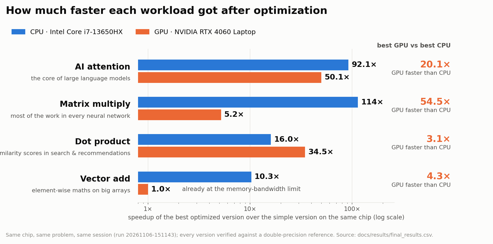</a> <b>The 4 workloads compared</b> · best version over the simple one, CPU and GPU

<a href="assets/media/gpu-roofline.png">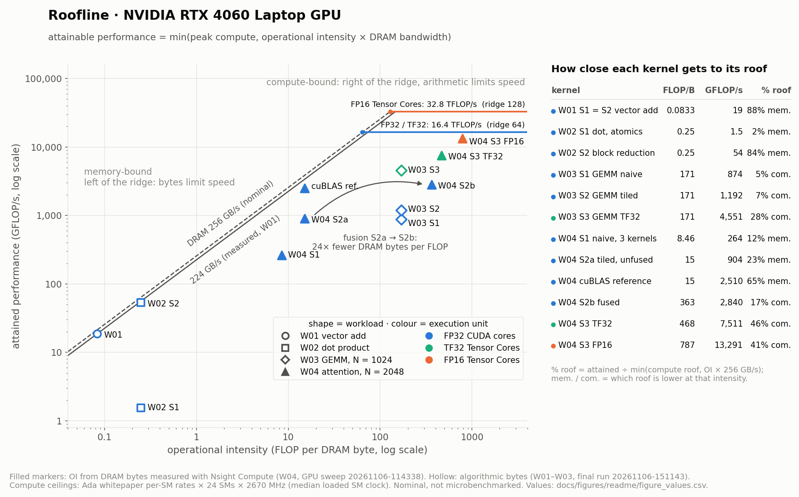</a> <b>Roofline</b> · every GPU stage against the RTX 4060 roofs

<a href="assets/media/gpu-every-stage.png">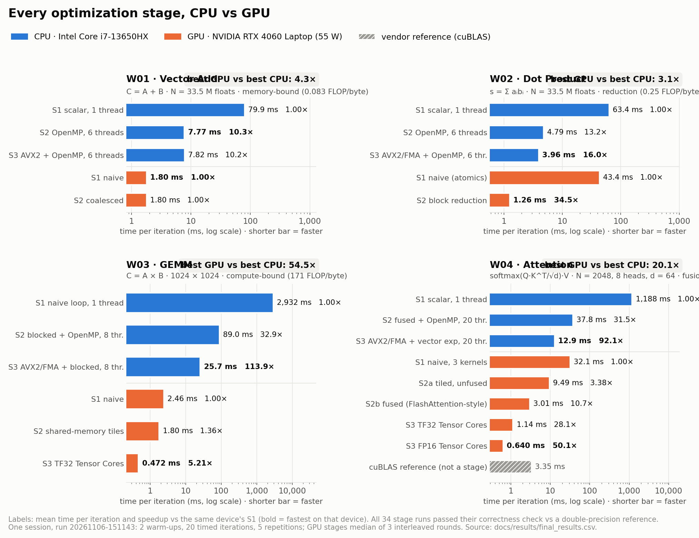</a> <b>Every optimization step</b> · time per iteration, CPU vs GPU, for each workload

**CPU vs GPU race** · every version of each task races on one shared clock. The race ends when the slowest version (the simple CPU code) finishes once. Longer bars mean faster code, drawn to true scale. The race slows to ¼ speed halfway through so you can see the differences.

- **Vector add:** the GPU is about **45×** faster than the simple CPU code. Better GPU code doesn't help, because memory speed is the limit.
- **Dot product:** smarter GPU code makes it **34.5×** faster, and about **50×** faster than the simple CPU code.
- **Matrix multiply:** optimising the CPU code makes it **114×** faster. The GPU's Tensor Cores go further: about **6,200×** faster than the simple CPU code and **55×** faster than the best CPU code.
- **Attention:** fusing the steps into one kernel, then using FP16 Tensor Cores, makes the GPU **50×** faster than its own simple version, and about **1,850×** faster than the simple CPU code.

https://github.com/user-attachments/assets/d3523712-bdd1-449d-b2c5-de477e8fd905

The race is a separate run from the charts above, so the figures differ slightly.

<b>Full walkthrough video (72 s)</b> · explains the comparison results: goes over each workload, each optimization step and the CPU vs GPU comparison

 

https://github.com/user-attachments/assets/09a2eef4-9177-4cbb-a606-08fad9ee938b

---

<picture>
  <source media="(prefers-color-scheme: dark)" srcset="assets/titles/02-dark.svg">
  
</picture>

<code>B.Tech project · 2026</code> · complete · <code>Python · NVIDIA Isaac Sim · PhysX · vision-language models (VLMs) · LoRA · OpenCV · ArUco · Dobot Magician</code>

**[Results, Comparisons, graphs & code](https://github.com/Fe3w/dobot-vlm-vla-pick-place)**

- **40 s → under 8 s** decision time, with no paid-API dependence, by distilling larger models into local vision-language models with LoRA.
- Consensus across up to **4** model providers before the arm acts. Python serial driver for the Dobot and ArUco-marker localization.

<b>Simulation: language-conditioned pick-and-place in NVIDIA Isaac Sim</b> Task: <i>"pick up the green cube and place it next to the cylinder"</i>. The vision-language model picks the target and reference objects, the planner routes around the other objects, and the arm places the cube and returns home.

<video src="https://github.com/user-attachments/assets/72f1b7c5-dcc6-4cdb-b394-a746c9420f2f" width="760" controls muted></video>

Type a task in plain English, such as *"pick up the green cube and place it next to the cylinder"*, and a Dobot Magician carries it out. There is no training data and there are no hand-taught waypoints. A vision-language model reads the task against an overhead camera image, but it only picks from numbered tags on the objects: what to pick, what to place it next to, and what to avoid. It never guesses coordinates. Camera rays cast into the scene turn those choices into 3D targets. Inverse kinematics and an obstacle-aware route planner then produce a collision-free path, and an automatic check confirms the object ended up where the task asked. Every task runs in NVIDIA Isaac Sim first. On the real arm, an ordinary phone camera, calibrated with ArUco markers, mirrors the table into the simulation, and the Dobot only replays a path that passed in simulation.

<a href="assets/media/vla-architecture.svg">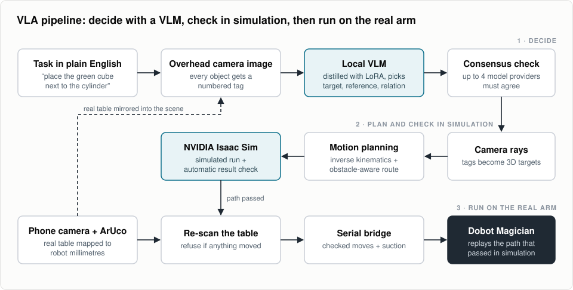</a> <b>Vision-Language-Action (VLA) architecture</b> · decide with a vision-language model, check in simulation, then run on the real arm

**On the real Dobot Magician** · phone camera, ArUco markers that map pixels to the robot frame, and live object detection with pick coordinates in mm, checked against the arm's reach envelope

<table>
  <tr>
    <td width="50%" align="center">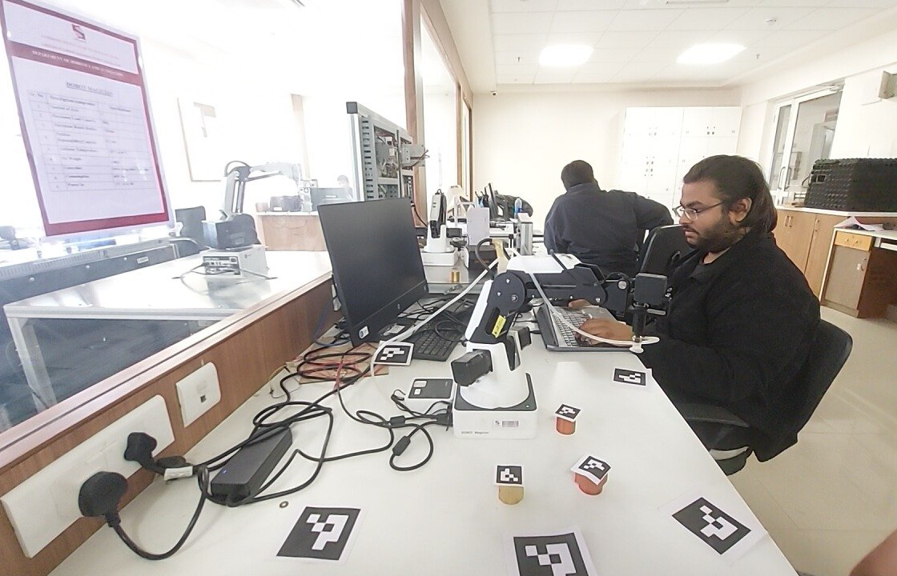 <b>Bench setup</b> · Dobot Magician, ArUco markers, test objects</td>
    <td width="50%" align="center">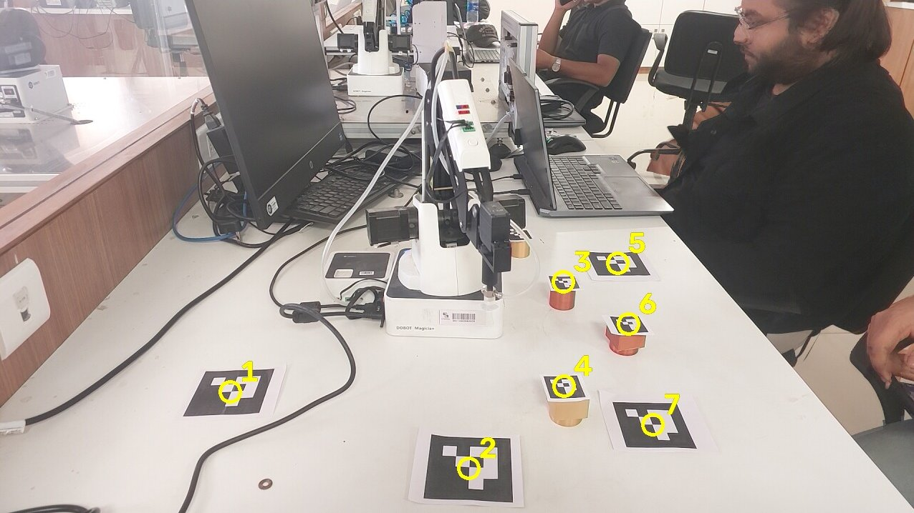 <b>Calibration</b> · numbered ArUco markers link camera pixels to robot coordinates</td>
  </tr>
</table>

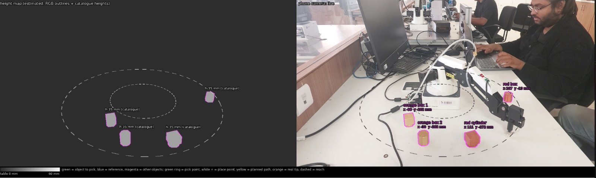 <b>Live detection</b> · height map (left) and camera view (right): each object is labelled with its x / y in mm and checked against the dashed reach rings

<b>Second detection frame</b> · the same detection after the objects are rearranged

 
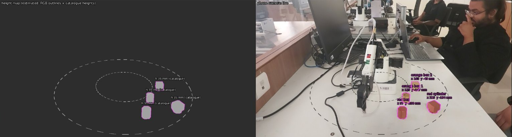

---

<picture>
  <source media="(prefers-color-scheme: dark)" srcset="assets/titles/03-dark.svg">
  
</picture>

<code>Personal project · Nov 2026</code> · complete · <code>SystemVerilog · Python · cocotb · Verilator · Yosys · nextpnr · OpenROAD (SKY130)</code>

**[Results, Comparisons, graphs & code](https://github.com/Fe3w/systolic-array-gemm-accelerator)**

A matrix-multiply engine built from scratch, in the style of a TPU matrix unit: a weight-stationary **8×8 array** of multiply-add units in SystemVerilog with DMA, ping-pong buffers, an int32 accumulator and a command controller, plus a **Python tiling compiler** that splits any GEMM into hardware commands and a cycle-accurate performance model that predicts the cycle count before the hardware runs.

  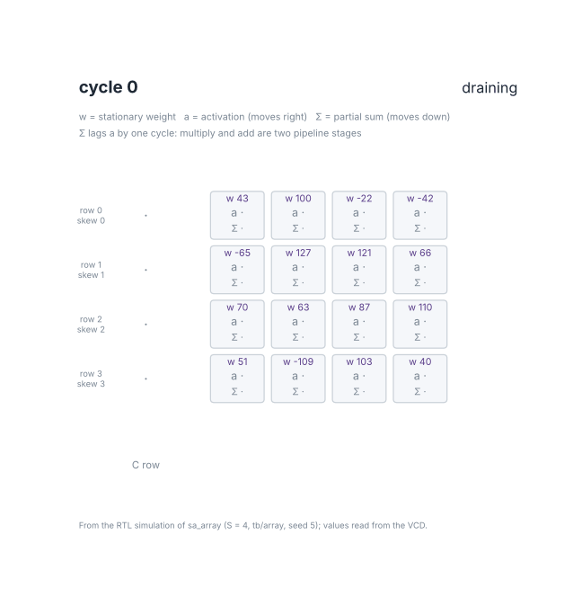 
  <b>The array at work</b> · one frame per clock cycle (4×4 version, straight from RTL simulation): weights load from the top, inputs flow in from the left, sums flow down

| Result | Value |
|---|---|
| Random GEMMs from the tiling compiler matching NumPy | **1,000 / 1,000** (cocotb + Verilator, tests written before each block's RTL) |
| PE utilization on a 256×256×256 GEMM, with double buffering | **0.44 → 0.78** · **1.77× fewer cycles** |
| Performance model vs measured hardware cycles | **16 / 16** exact |
| FPGA flow · Lattice ECP5 (Yosys + nextpnr) | core clock **60.55 → 98.93 MHz** |
| ASIC flow · SkyWater SKY130 (OpenROAD) | **1.05 mm² core**, placed and routed, timing met at 66.7 MHz |

<a href="assets/media/sysarray-architecture.png">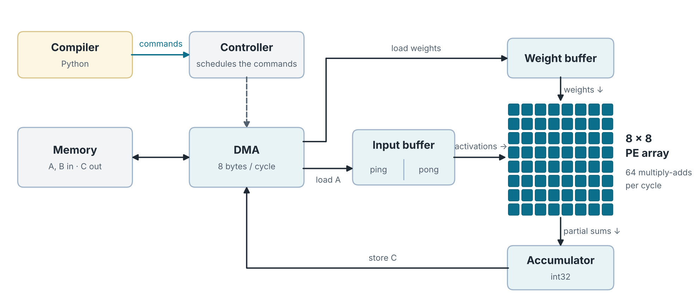</a> <b>Architecture</b> · compiler → controller → DMA → buffers → 8×8 PE array → accumulator

<table>
  <tr>
    <td width="50%" valign="top"> <b>Utilization</b> · first version vs double buffering, per layer, with the model's prediction</td>
    <td width="50%" valign="top"><a href="assets/media/sysarray-roofline.png">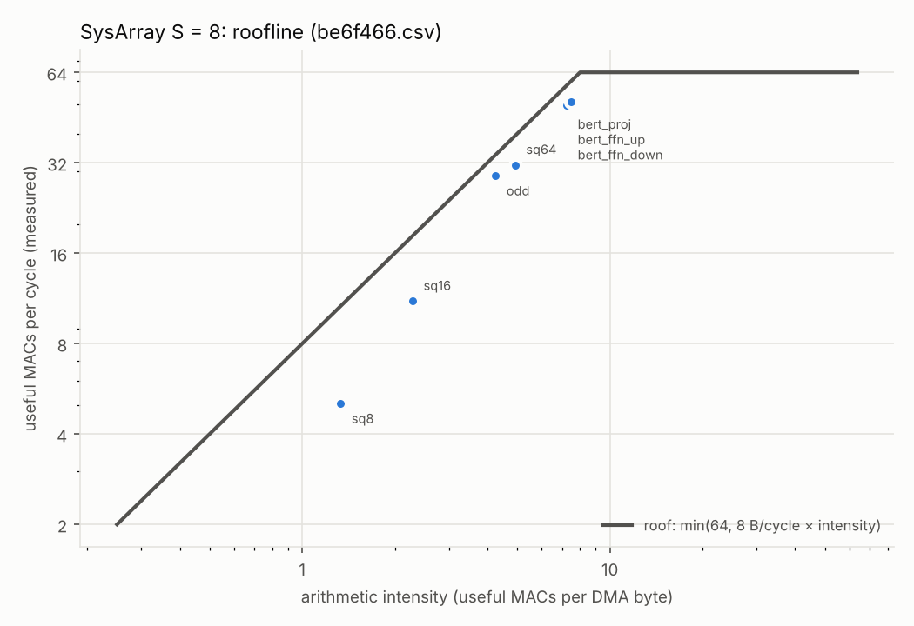</a> <b>Roofline</b> · useful MACs per cycle against arithmetic intensity</td>
  </tr>
</table>

---

<picture>
  <source media="(prefers-color-scheme: dark)" srcset="assets/titles/04-dark.svg">
  
</picture>

<code>Personal project · Oct to Nov 2026</code> · code private · demo coming soon · <code>Ollama · local LLMs · Whisper · Python · Kotlin (Android) · Google OAuth · Google Cloud APIs · AES-256-GCM · SQLite · Trilium</code>

Speak a thought into the phone ("research idea…", "gym…", "journal…") and it becomes a structured English page on the laptop, with **no cloud AI and no server**. The Android app records offline and uploads end-to-end encrypted objects to Google Drive's hidden app folder. The laptop transcribes them with Whisper and a local LLM on an 8 GB GPU, turns English and Hindi speech into a title, summary, decisions and next actions, each item backed by a quote from the transcript, and syncs the result back to the phone. If a note asks for something ("research the last three years of X"), the laptop drafts a plan, I approve it on the phone, and it writes a cited report using free tools.

The laptop coordinates every stage on one 8 GB GPU: speech-to-text and the LLM never run at the same time, a planner, executor, reader and writer run the research agent with checkpoints and time budgets, and agent jobs pause whenever a new voice note arrives so notes always go first.

- **6 of 6** Hindi test notes translated by the chosen model (vs 1 of 6 for a larger model), with all **62** extracted items quoted from the transcript.
- **0** notes lost and **0** duplicates when a proxy cut **35%** of connections, using AES-256-GCM objects authenticated by name and UUIDv7 idempotency keys.
- Research agent with plan-and-approve on the phone: false automatic runs cut from **5 to 0** on 36 test phrasings, by requiring the model and a deterministic rule check to agree.

<a href="assets/media/voice-notes-architecture.svg">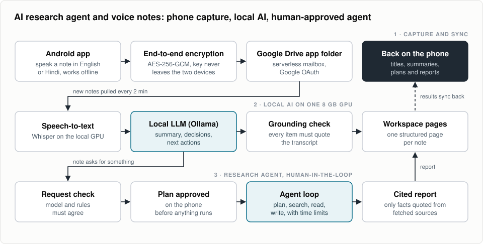</a> <b>Architecture</b> · phone capture, local AI on one GPU, human-approved research agent

<table>
  <tr>
    <td width="50%" valign="top"> <b>Demo video</b> · coming soon</td>
    <td width="50%" valign="top">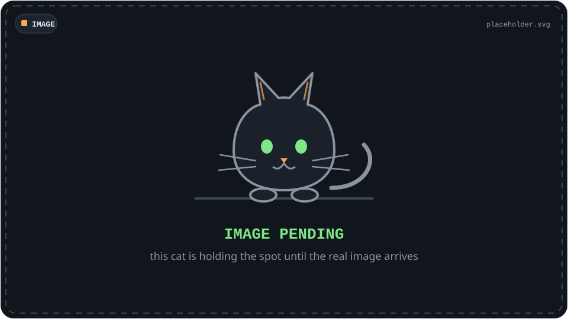 <b>Screenshots</b> · coming soon</td>
  </tr>
</table>

<!-- voice-notes media -->

---

<picture>
  <source media="(prefers-color-scheme: dark)" srcset="assets/titles/05-dark.svg">
  
</picture>

<code>Personal project · Nov 2026</code> · complete · <code>C++ · LLVM 20 · compilers · Clang · GCC · ScalarEvolution · DependenceAnalysis · lit / FileCheck · GitHub Actions</code>

**[Results, Comparisons, graphs & code](https://github.com/Fe3w/Loop-Vectorization-Analyzer)** · **[Write-up](https://github.com/Fe3w/Loop-Vectorization-Analyzer/blob/main/docs/writeup.md)** · **[Bug reproducer](https://github.com/Fe3w/Loop-Vectorization-Analyzer/blob/main/test/interchange/confused-miscompile.test)**

Why did LLVM leave this loop scalar? A plugin that runs inside `clang -O3` just before the loop vectorizer, explains each rejected loop from LLVM's own analyses with a category, the evidence and a source-level fix, checks its answers against LLVM, and repairs one class of blocked loops. 204 lit/FileCheck tests run in GitHub Actions.

- **168 of 180** mostly held-out TSVC loops (**93.3%**, x86-64): same reason as LLVM's own vectorizer. PolyBench 163 of 163 was the tuning set.
- **13 of 14** suggested fixes make LLVM vectorize the loop.
- Repair pass: up to **5.79×** on cholesky with `-ffast-math -march=native` (**1.05×** in strict FP), 60 of 60 strict-FP outputs byte-identical.
- Found and reproduced a **wrong-result bug in LLVM 20.1.2's loop-interchange pass** (checksum 1,961,666 → 171,990), fixed in LLVM 21.

<a href="assets/media/lva-headline.svg">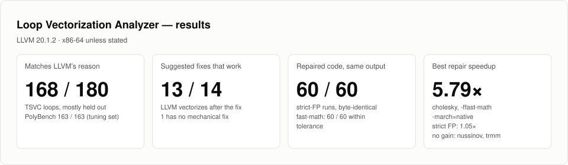</a>

<table>
  <tr>
    <td width="50%" valign="top"><a href="assets/media/lva-pipeline.svg">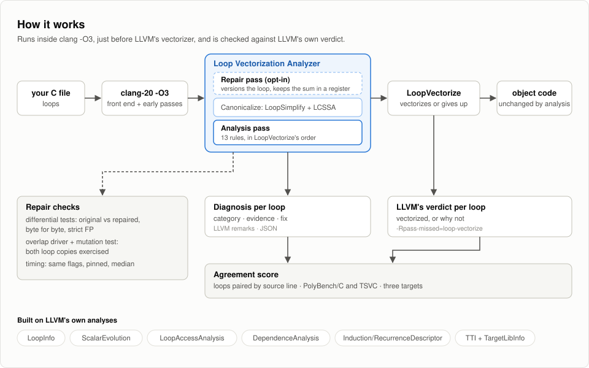</a> <b>How it works</b> · runs at LLVM's VectorizerStart point, scored against LLVM's remarks</td>
    <td width="50%" valign="top"><a href="assets/media/lva-agreement.svg">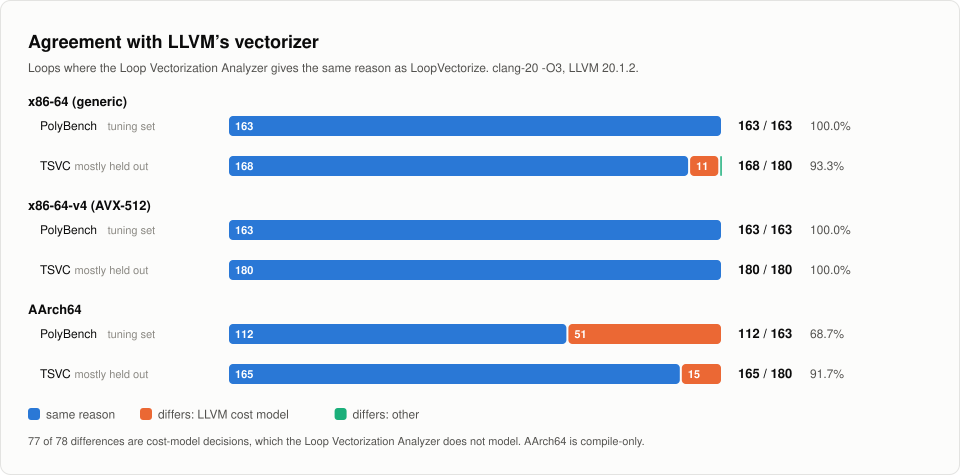</a> <b>Agreement</b> · with LLVM's vectorizer, per target and suite</td>
  </tr>
  <tr>
    <td width="50%" valign="top"><a href="assets/media/lva-speedup.svg">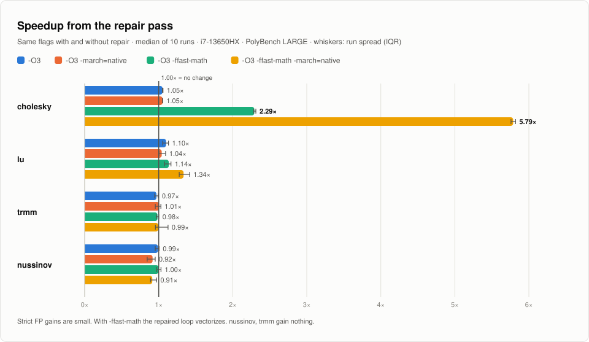</a> <b>Repair speedup</b> · per kernel and flag set</td>
    <td width="50%" valign="top"> <b>LLVM 20.1.2 bug</b> · loop-interchange wrong result, fixed in LLVM 21</td>
  </tr>
</table>

---

<picture>
  <source media="(prefers-color-scheme: dark)" srcset="assets/titles/06-dark.svg">
  
</picture>

<code>Jan to Jun 2026</code> · <b>Design Lead and Team Co-Head</b> · Team Robominds, Symbiosis Institute of Technology · National Robotics Competition

Responsible for CAD design and integration of both robots, oversaw and coordinated the build, and kept the simulation in line with the physical robots.

- Reached the **National Finals at IIT Delhi**, one of **39 institutions** in India's qualifier for ABU Robocon, after scoring **90/100** in Stage 1.
- Led the largest sub-team (about 10 designers) through **9 major design iterations** of two robots under the contest's weight and size limits, managing fabrication and keeping simulation and electrical work aligned with the design.
- Designed a 25 kg omni-wheel robot and a 20 kg six-wheel rocker-bogie robot, a scissor lift sized with a **3,000 N** actuator against a 1,320 N worst-case load (safety factor 2.27), and a 5-DoF arm sized for 113.6 kg-cm torque.
- Grew the team from **6 core members to 55** (35 active daily) through recruitment, an outreach event for over 80 students and design, computer vision and simulation workshops.

**[Technical Document](https://drive.google.com/file/d/1hJCpC_qRZUSHyYDyhoY7EmVvnCkF-aHr/view?usp=sharing)** · **[Stage 1 Result](https://www.linkedin.com/posts/robocon2026-robotics-innovation-ugcPost-7437088494499414016-Bv9j/)** · **[Finals Selection](https://www.linkedin.com/posts/vulavakattu-ena-vamsi_ddrobocon2026-teamrobominds-sitpune-share-7467160726441431040-KbPs/)** · **[LinkedIn Post](https://www.linkedin.com/posts/abhishek-singh-a2003b287_robocon2026-teamrobominds-automation-ugcPost-7438862846412771328-uZSR)**

https://github.com/user-attachments/assets/18fe45f4-467c-4aaa-97d2-063ad31eb409

---

<picture>
  <source media="(prefers-color-scheme: dark)" srcset="assets/titles/07-dark.svg">
  
</picture>

#### Gesture-Controlled Robotic Hand (Computer Vision)
3D-printed hand driven by real-time OpenCV/MediaPipe hand tracking. Commands stream over MQTT to an ESP32 in **under 100 ms**. I wrote the ESP32 subscriber firmware and made CAD changes for mechanical alignment.

https://github.com/user-attachments/assets/1f63cb8e-624d-42df-a676-d73537d68324

#### ROS 2 TurtleBot3 Target Tracking with LiDAR Collision Avoidance
<code>Python · ROS 2 Humble · Gazebo · TurtleBot3 · OpenCV</code> · **[Results, Comparisons, graphs & code](https://github.com/Fe3w/Pepermint_task1_abhishek)**

A two-node ROS 2 package: OpenCV visual servoing chases a target, and a LiDAR check stops the robot at 0.5 m, in Gazebo.

<b>TurtleBot3 videos</b> · target pursuit and LiDAR stop

 

**Target search, acquisition and pursuit** · the TurtleBot3 rotates in place to locate the target, then follows it using proportional visual servoing on the image-centre error.

https://github.com/user-attachments/assets/8b71ba75-8a89-4cfd-ae5a-b8ca14dbee04

**LiDAR-based collision avoidance** · as the robot closes in, the frontal-cone range check commands zero velocity before contact.

https://github.com/user-attachments/assets/fcea9351-c6b0-4003-a7d3-23be096ce114

<b>Python tooling</b>

 

- OCR-based PDF retrieval (PyMuPDF, pytesseract): scans nested folders, falls back to OCR on scanned pages, finds PDFs by keyword
- Face-similarity search integrated with the Google Drive API (OAuth)
- Automated image-dataset preprocessing and splitting for CNN training
- Scripted Gazebo simulation runs; used the data to fine-tune bipedal robot control models

---

<picture>
  <source media="(prefers-color-scheme: dark)" srcset="assets/titles/08-dark.svg">
  
</picture>

Robotics & Automation engineering student (Honors in Embedded Systems, class of 2027) from Symbiosis Institute of Technology, Pune. I work across the stack: at the low end, the kernels, compilers and hardware that decide how fast AI runs, and at the high end, perception, high-level robotics and physical AI.

**Open to internships and graduate roles in:**

1. **Compilers, computer architecture and performance engineering:** GPU and CPU optimization, LLVM, hardware accelerators
2. **Applied AI and forward-deployed engineering (FDE):** AI integration, model optimization and distillation, local and cloud AI agents
3. **Perception, high-level robotics and physical AI**

#### Education

- **B.Tech, Robotics & Automation Engineering** · Honors in Embedded & Automotive Systems · Symbiosis Institute of Technology, Pune · CGPA 7.65 · expected June 2027

#### Certifications & coursework

- **Stanford Online:** [Compilers](https://www.edx.org/learn/computer-science/stanford-university-compilers) (edX)
- **Independent study:** Cornell CS 6120 Advanced Compilers (LLVM IR, analysis, optimization) · MIT 6.S894 Accelerated Computing (GPU programming, CUDA)
- **Advanced VLSI Design** (Compcarta): SystemVerilog, digital design, testing
- **NPTEL:** Deep Learning for Computer Vision (IIT Hyderabad) · Advanced Robotics (IIT Kanpur)
- **MathWorks:** MATLAB, Simulink, Stateflow Onramps

---

<picture>
  <source media="(prefers-color-scheme: dark)" srcset="assets/titles/09-dark.svg">
  
</picture>

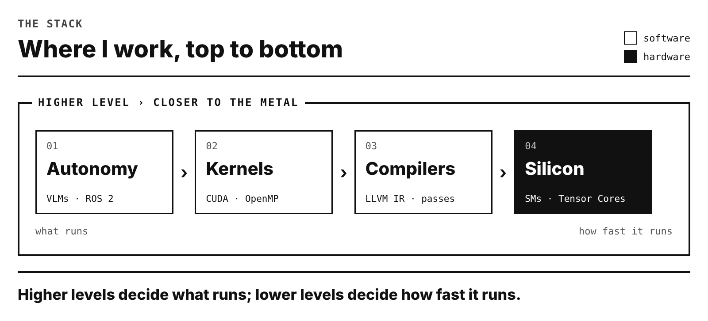

<b>Full skills list</b> (text)

 

| Compilers & performance | Parallel & GPU | Autonomy & embedded | ML & vision |
|---|---|---|---|
| LLVM / Clang · LLVM IR | CUDA · PTX · WMMA | ROS 2 (Humble / Jazzy) · Gazebo | Qwen2.5-VL · InternVL3.5 fine-tuning |
| New-pass-manager plugins | OpenMP · AVX2 / FMA | NVIDIA Isaac Sim · Dobot Magician | Synthetic data pipelines |
| Roofline · arithmetic intensity | TF32 / FP16 Tensor Cores | STM32 · ESP32 · RTOS concepts | OpenCV · MediaPipe |
| Nsight Compute / Systems · Intel VTune | Cache blocking · shared-memory tiling · kernel fusion | UART / SPI / I²C / CAN · MQTT | Keras · NumPy · Pandas |
| GCC · micro-benchmarking | Ampere / Hopper SM architecture | MATLAB · Simulink · Stateflow | SystemVerilog · Intel Quartus |

**Hardware design & verification:** SystemVerilog · cocotb · Verilator · Yosys · nextpnr · OpenROAD (SKY130) · Lattice ECP5 
**Local AI & apps:** faster-whisper · Ollama · LoRA fine-tuning · Kotlin · Jetpack Compose · SQLite · AES-GCM

---

<picture>
  <source media="(prefers-color-scheme: dark)" srcset="assets/titles/10-dark.svg">
  
</picture>

**Working on compilers, GPU performance or autonomous systems that need to run faster? Say hello.**

**Email:** abhishekp135531@gmail.com

[Email](mailto:abhishekp135531@gmail.com) · [LinkedIn](https://www.linkedin.com/in/abhishek-singh-a2003b287/) · [GitHub](https://github.com/Fe3w) · [LeetCode](https://leetcode.com/u/Abhishek_P_S_/) · [X](https://x.com/Fe3ws_)

`COMPILERS · GPU PERFORMANCE · AUTONOMOUS SYSTEMS` · Pune, Maharashtra, IN

 

