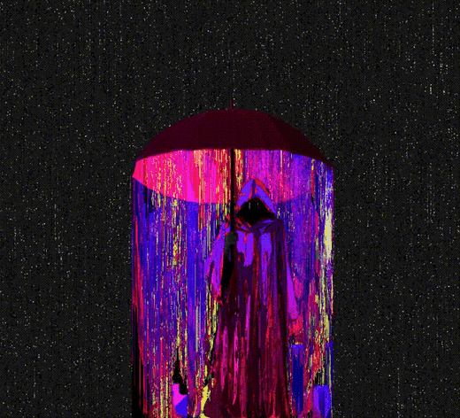

# Abhishek Prakash Singh

**Compilers · CPU/GPU Performance · Hardware Accelerators · Robotics AI**

B.Tech, Robotics & Automation Engineering (Honors: Embedded Systems), Symbiosis Institute of Technology, Pune, May 2027.

Seeking internships and graduate roles in compiler optimization, CPU/GPU performance, hardware accelerators, systems software and robotics AI.

[Email](mailto:abhishekp135531@gmail.com) · [LinkedIn](https://www.linkedin.com/in/abhishek-singh-a2003b287/) · [GitHub](https://github.com/Fe3w)

---

## Featured projects

**Loop Vectorization Analyzer (LLVM compiler plugin)** · Personal Project · Nov 2026 · [Repo](https://github.com/Fe3w/Loop-Vectorization-Analyzer) · [Write-up](https://github.com/Fe3w/Loop-Vectorization-Analyzer/blob/main/docs/writeup.md) · [Bug reproducer](https://github.com/Fe3w/Loop-Vectorization-Analyzer/blob/main/test/interchange/confused-miscompile.test)

LLVM 20 pass plugin in C++ that explains why the loop vectorizer rejects a loop, with 204 lit/FileCheck tests in GitHub Actions.

- **168 of 180** mostly held-out TSVC loops (93.3%, x86-64): the plugin's reason matches LLVM's own.
- **13 of 14** suggested fixes make LLVM vectorize the loop. The repair transform reached up to **5.79x** on cholesky with `-ffast-math -march=native` (1.05x in strict FP), with 60 of 60 strict-FP outputs byte-identical.
- **Wrong-result bug** in LLVM 20.1.2's loop-interchange pass found and reproduced (checksum 1,961,666 to 171,990), fixed in LLVM 21.

**SysArray: 8x8 int8 systolic-array GEMM accelerator** · Personal Project · Nov 2026 · [Repo](https://github.com/Fe3w/systolic-array-gemm-accelerator)

Weight-stationary 8x8 array in SystemVerilog with DMA, buffers, int32 accumulator and command controller, plus a Python tiling compiler and cycle-accurate performance model.

- **1,000 of 1,000** random GEMMs generated by the tiling compiler match NumPy (cocotb + Verilator tests written before each block's RTL).
- **0.44 to 0.78** utilization from double buffering on a 256x256x256 GEMM (**1.77x fewer cycles**). The performance model predicts hardware cycles exactly in 16 of 16 runs.
- **60.55 to 98.93 MHz** core clock in the FPGA flow (Lattice ECP5, Yosys + nextpnr). **1.05 mm² core** in the ASIC flow (SkyWater SKY130, OpenROAD), placed and routed, timing met at 66.7 MHz.

**CPU and GPU kernel optimization and Roofline profiling** · B.Tech Specialization Project and Conference Paper · 2026 · [Project report](https://drive.google.com/file/d/1XhWOYI6mYyLRbKIm25UFTFQibAgZOgr0/view?usp=sharing) · [Paper](https://drive.google.com/file/d/1Iqg1ht8dw_D7Ud5cnDXnYjy3pSv4l__W/view?usp=sharing) · [Code](https://github.com/Fe3w/GPU-CPU-Performance-Profiling_and-Optimization)

C++ and CUDA kernels on an Intel i7-13650HX CPU and RTX 4060 Laptop GPU, all 34 runs verified against a double-precision reference. The paper was presented and defended at a conference before a review panel.

- **50.1x** over an unfused baseline for a FlashAttention-style fused attention kernel at 0.03% error (online softmax, FP16 Tensor Cores).
- **114x** on CPU GEMM (0.73 to 83.4 GFLOP/s) with cache blocking, OpenMP and AVX2.
- **24x** less DRAM traffic from fusion but only 15% less runtime (Nsight Compute), so register tiling and Tensor Cores drove the speed-up.

Media: [overview video](https://github.com/user-attachments/assets/09a2eef4-9177-4cbb-a606-08fad9ee938b) · [CPU vs GPU race video](https://github.com/user-attachments/assets/d3523712-bdd1-449d-b2c5-de477e8fd905) · charts: [speedup](assets/media/gpu-speedup.png), [Roofline](assets/media/gpu-roofline.png), [every stage](assets/media/gpu-every-stage.png), [attention steps](assets/media/gpu-attention-steps.png)

**Neuro-symbolic VLA for robotic pick-and-place (Dobot Magician)** · B.Tech Project · 2026 · [Repo and demo video](https://github.com/Fe3w/dobot-vlm-vla-pick-place)

A VLM makes symbolic choices (target, reference object, relation) and a kinematics layer turns them into arm motions, validated in NVIDIA Isaac Sim. Python serial driver and ArUco-marker localization.

- **40 s to under 8 s** decision time, with no paid-API dependence, by distilling larger models into local VLMs with LoRA.
- **Up to 4** model providers must reach consensus before the arm acts.

Media: [Isaac Sim demo video](https://github.com/user-attachments/assets/72f1b7c5-dcc6-4cdb-b394-a746c9420f2f) · photos: [bench setup](assets/media/dobot-lab-setup.jpg), [ArUco calibration](assets/media/dobot-aruco-calibration.jpg), [live detection 1](assets/media/dobot-detection-1.jpg), [live detection 2](assets/media/dobot-detection-2.jpg)

---

## Also built

**Private voice notes with local AI** · Personal Project · Oct to Nov 2026

Android app (Kotlin) and laptop service (Python): spoken English and Hindi notes become structured pages with no cloud AI (Whisper and a local LLM on an 8 GB GPU), with end-to-end encrypted sync over Google Drive's hidden app folder.

- **6 of 6** Hindi test notes translated by the chosen model (vs 1 of 6), with all 62 extracted items quoted from the transcript.
- **5 to 0** false automatic runs of the research agent on 36 test phrasings, after adding plan-and-approve on the phone.

Demo video, screenshots and architecture diagram: coming soon.

<!-- voice-notes media -->

---

## Experience and competitions

**DD Robocon 2026, Team Robominds** · Design Lead and Team Co-Head · Jan to Jun 2026 · [LinkedIn post](https://www.linkedin.com/posts/abhishek-singh-a2003b287_robocon2026-teamrobominds-automation-ugcPost-7438862846412771328-uZSR) · [Technical Document](https://drive.google.com/file/d/1hJCpC_qRZUSHyYDyhoY7EmVvnCkF-aHr/view?usp=sharing) · [Stage 1 Result](https://www.linkedin.com/posts/robocon2026-robotics-innovation-ugcPost-7437088494499414016-Bv9j/) · [Finals Selection](https://www.linkedin.com/posts/vulavakattu-ena-vamsi_ddrobocon2026-teamrobominds-sitpune-share-7467160726441431040-KbPs/)

- Reached the **National Finals at IIT Delhi** (one of 39 institutions in India's qualifier for ABU Robocon) after scoring **90/100** in Stage 1.
- Led the largest sub-team (about 10 designers) through **9** major design iterations of two robots. Team grew from 6 core members to 55.

Competition video

 

https://github.com/user-attachments/assets/18fe45f4-467c-4aaa-97d2-063ad31eb409

---

## Other projects

- **EMG + computer-vision robotic hand:** 3D-printed hand driven by EMG input and a real-time OpenCV/MediaPipe gesture tracker. Commands stream over MQTT to an ESP32 in under 100 ms.
- **Drone CAD for Robofest:** Siemens NX drone assembly, focused on packaging, structural layout and balance.
- **ROS 2 TurtleBot3 target tracking:** OpenCV visual servoing with a LiDAR safety stop at 0.5 m in Gazebo. [Repo](https://github.com/Fe3w/Pepermint_task1_abhishek)
- **Python tooling:** OCR-based PDF retrieval, face-similarity search with the Google Drive API, image-dataset preprocessing for CNN training, scripted Gazebo runs.

Robotic hand video

 

https://github.com/user-attachments/assets/1f63cb8e-624d-42df-a676-d73537d68324

Drone CAD views

 

 

TurtleBot3 videos: target pursuit and LiDAR stop

 

**Target search, acquisition and pursuit**

https://github.com/user-attachments/assets/8b71ba75-8a89-4cfd-ae5a-b8ca14dbee04

**LiDAR-based collision avoidance**

https://github.com/user-attachments/assets/fcea9351-c6b0-4003-a7d3-23be096ce114

Coursework and certifications

 

- **Independent study:** Cornell CS 6120 Advanced Compilers (LLVM IR, analysis, optimization) · MIT 6.S894 Accelerated Computing (GPU programming, CUDA)
- **Advanced VLSI Design** (Compcarta): SystemVerilog, digital design, testing
- **NPTEL:** Deep Learning for Computer Vision (IIT Hyderabad) · Advanced Robotics (IIT Kanpur)
- **MathWorks:** MATLAB, Simulink, Stateflow Onramps

---

## Planned

- Mini C-like compiler with an LLVM IR backend (planned, not started).

---

## Skills

- **Languages:** C++, C, Python, CUDA, SystemVerilog, Kotlin
- **Compilers & performance:** LLVM (pass plugins, ScalarEvolution, DependenceAnalysis), Clang, lit/FileCheck, OpenMP, AVX2, Nsight Compute, VTune, Roofline analysis
- **Hardware:** systolic arrays, cocotb, Verilator, Yosys, nextpnr, OpenROAD (SKY130), FPGA timing closure
- **Robotics & AI:** ROS 2, Gazebo, NVIDIA Isaac Sim, OpenCV, VLMs, LoRA fine-tuning, local LLMs (Ollama), faster-whisper
- **Embedded & tools:** STM32, ESP32, RTOS, UART/SPI/I2C/CAN, Linux, Git, GitHub Actions, MATLAB/Simulink, Siemens NX, Fusion 360

Stack diagram

 

---

## Contact

[Email](mailto:abhishekp135531@gmail.com) · [LinkedIn](https://www.linkedin.com/in/abhishek-singh-a2003b287/) · [GitHub](https://github.com/Fe3w) · [LeetCode](https://leetcode.com/u/Abhishek_P_S_/) · [X](https://x.com/Fe3ws_)

Pune, Maharashtra, India

  
    
  
   
  Hourglass and umbrella art by <a href="https://x.com/Ki11_5trike"><b>@Ki11_5trike</b></a>

