<!--
  Style: black, white and greys; square frames; Inter + DejaVu Sans Mono.
  Graphics: python tools/make_mono.py (banner, stack)
  Videos: a bare https://github.com/user-attachments/assets/<id> URL on its own
  line (blank line above and below) renders as GitHub's video player.
-->

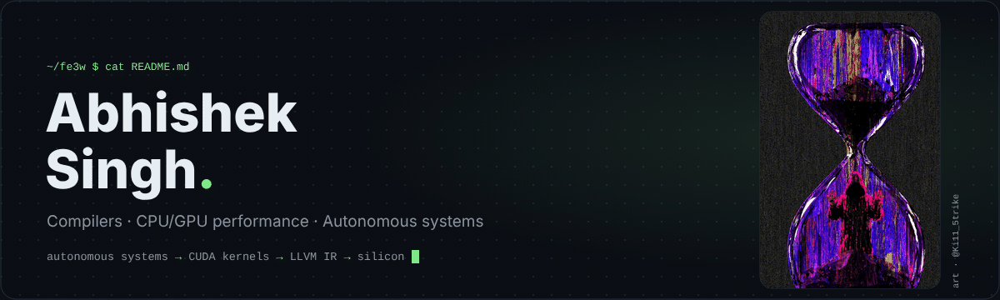

  <a href="#whoami"><code>01 WHOAMI</code></a> ·
  <a href="#stack"><code>02 STACK</code></a> ·
  <a href="#performance"><code>03 PERFORMANCE</code></a> ·
  <a href="#compilers"><code>04 COMPILERS</code></a> ·
  <a href="#autonomy"><code>05 AUTONOMY</code></a> ·
  <a href="#builds"><code>06 BUILDS</code></a> ·
  <a href="#contact"><code>07 CONTACT</code></a>

Pune, IN · B.Tech, class of 2027 · Honors in Embedded Systems · DD Robocon 2026 National Finalist · open to compiler and performance internships

---

### `01 — WHOAMI`

Final-year Robotics & Automation student (Honors in Embedded Systems) at Symbiosis Institute of Technology, Pune, **working my way down the stack**. I started with autonomous systems that perceive, decide and act. Now most of my time goes to what sits underneath them: the kernels, the compilers and the hardware that decide how fast any of it runs.

- **Currently building:** an LLVM loop-analysis pass and a C-like compiler with an LLVM IR backend
- **Recently shipped:** a FlashAttention-style fused attention kernel, **50× faster** than naive on an RTX 4060 ([repo](https://github.com/Fe3w/GPU-CPU-Performance-Profiling_and-Optimization))
- **Looking for:** internships in compiler optimization, CPU/GPU performance engineering, systems software and accelerated computing
- **Ask me about:** roofline models, why a GEMM is memory-bound until it isn't, LLVM's new pass manager, perception-to-control pipelines in ROS 2
- **Off-keyboard:** led design for Team Robominds to the DD Robocon 2026 National Finals at IIT Delhi

---

### `02 — STACK`

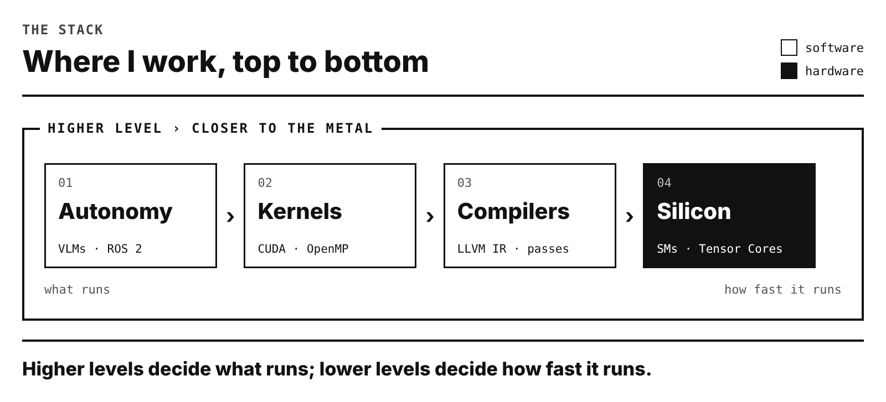

<b>Full skills list</b> (text)

 

| Compilers & performance | Parallel & GPU | Autonomy & embedded | ML & vision |
|---|---|---|---|
| LLVM / Clang · LLVM IR | CUDA · PTX · WMMA | ROS 2 (Humble / Jazzy) · Gazebo | Qwen2.5-VL · InternVL3.5 fine-tuning |
| New-pass-manager plugins | OpenMP · AVX2 / FMA | NVIDIA Isaac Sim · Dobot Magician | Synthetic data pipelines |
| Roofline · arithmetic intensity | TF32 / FP16 Tensor Cores | STM32 · ESP32 · RTOS concepts | OpenCV · MediaPipe |
| Nsight Compute / Systems · Intel VTune | Cache blocking · shared-memory tiling · kernel fusion | UART / SPI / I²C / CAN · MQTT | Keras · NumPy · Pandas |
| GCC · micro-benchmarking | Ampere / Hopper SM architecture | MATLAB · Simulink · Stateflow | SystemVerilog · Intel Quartus |

---

### `03 — PERFORMANCE ENGINEERING`

#### Heterogeneous CPU/GPU Performance Analysis & Roofline Profiling
<code>Honors project · 2026</code> · complete · v1.1 · <code>C++ · CUDA · WMMA · OpenMP · AVX2/FMA · Nsight Compute · Nsight Systems · VTune</code>

[**Repository →**](https://github.com/Fe3w/GPU-CPU-Performance-Profiling_and-Optimization) · [**Project report**](https://drive.google.com/file/d/1XhWOYI6mYyLRbKIm25UFTFQibAgZOgr0/view?usp=sharing) · [**Seminar paper**](https://drive.google.com/file/d/1Iqg1ht8dw_D7Ud5cnDXnYjy3pSv4l__W/view?usp=sharing)

How far are textbook kernels from what the hardware can actually do, and *why*? Four workloads (vector add, dot product, matrix multiply and **Transformer attention**) optimized in three stages each on an **Intel Core i7-13650HX** and an **NVIDIA RTX 4060 Laptop GPU**, verified against double precision, and explained with profiling and Roofline analysis.

| Kernel | Arithmetic intensity | CPU speedup | GPU speedup | What limits it |
|---|---|---|---|---|
| Vector add | 0.083 FLOP/byte | **10.3×** | **1.0×** | memory-bound: 224 GB/s, 88% of DRAM peak |
| Dot product | 0.25 FLOP/byte | **16.0×** | **34.5×** | block reduction removes the single-address atomic bottleneck |
| GEMM | 171 FLOP/byte | **114×** · 0.73 → 83.4 GFLOP/s | **5.2×** · 874 → 4,551 GFLOP/s | shared-memory tiling, then TF32 Tensor Cores |
| Attention | 15 → 363 FLOP/byte | **92.1×** | **50.1×** · 13.5 TFLOP/s | fusion cuts DRAM traffic 24–31×, then FP16 Tensor Cores |

CPU: cache blocking · OpenMP · AVX2/FMA. GPU: coalescing · block reduction · shared-memory tiling · FlashAttention-style fusion · TF32/FP16 WMMA Tensor Cores. All 34 stage runs verified against a double-precision reference · TF32 GEMM error <b>0.004%</b> · FP16 attention <b>0.03%</b>. One session, run <code>20261106-151143</code>.

<table>
  <tr>
    <td width="50%" valign="top"><a href="assets/media/gpu-speedup.png">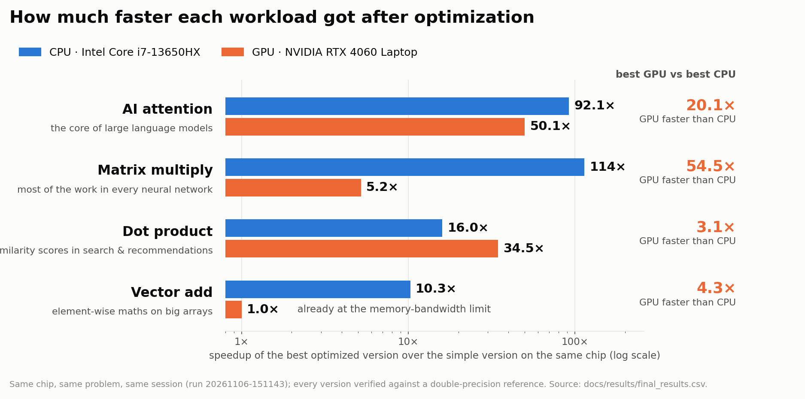</a> <b>Speedup</b> · best version over the simple one, per workload</td>
    <td width="50%" valign="top"><a href="assets/media/gpu-roofline.png">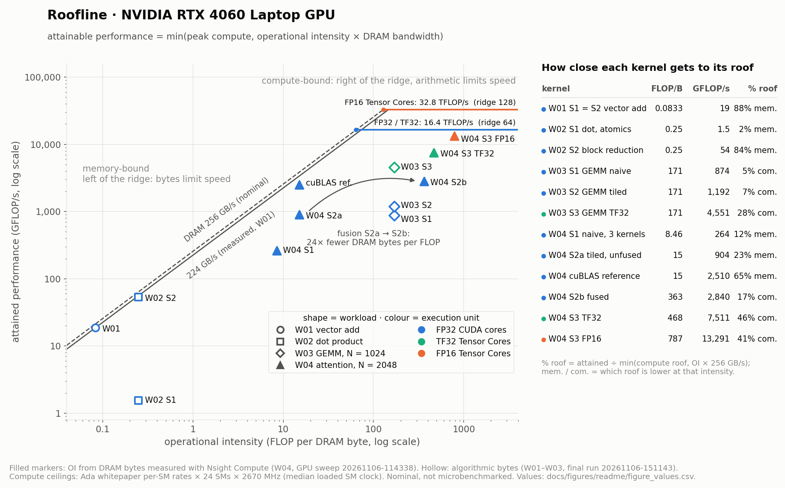</a> <b>Roofline</b> · every GPU stage against the RTX 4060 roofs</td>
  </tr>
  <tr>
    <td width="50%" valign="top"><a href="assets/media/gpu-every-stage.png">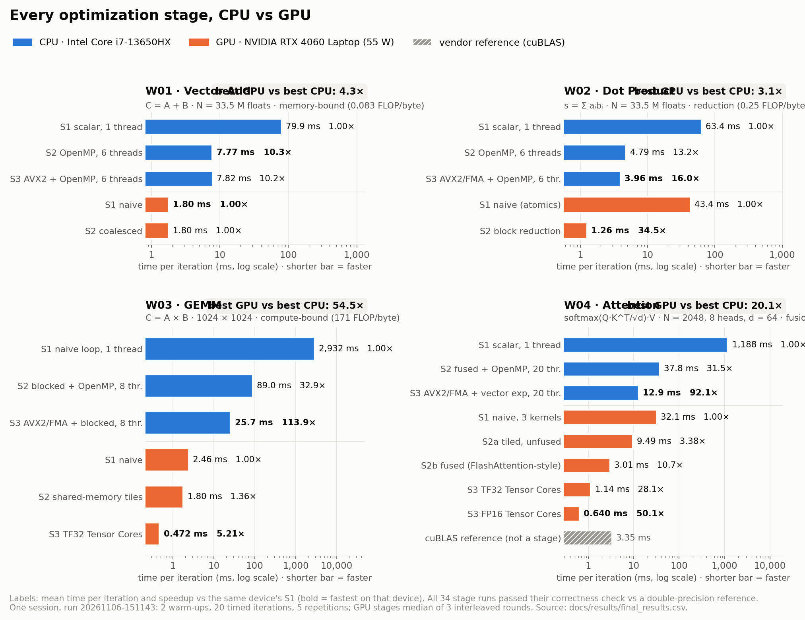</a> <b>Every stage</b> · time per iteration, CPU vs GPU, W01 to W04</td>
    <td width="50%" valign="top"><a href="assets/media/gpu-attention-steps.png">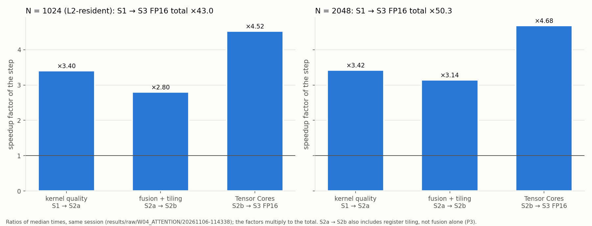</a> <b>Attention</b> · where the 50× comes from: kernels, fusion, Tensor Cores</td>
  </tr>
</table>

Click any chart to open it full size. More figures in the <a href="https://github.com/Fe3w/GPU-CPU-Performance-Profiling_and-Optimization">repository</a>.

**Every workload, CPU vs GPU, in 72 seconds** · animated from the final measurements: the optimization ladder, where each speedup comes from, the Roofline, and why the attention kernel ends up 50× faster.

https://github.com/user-attachments/assets/09a2eef4-9177-4cbb-a606-08fad9ee938b

**CPU vs GPU race** · every version of each task races on one shared clock. The race ends when the slowest version (the simple CPU code) finishes once. Longer bars mean faster code, drawn to true scale. The race slows to ¼ speed halfway through so you can see the differences.

- **Vector add:** the GPU is about **45×** faster than the simple CPU code. Better GPU code doesn't help, because memory speed is the limit.
- **Dot product:** smarter GPU code makes it **34.5×** faster, and about **50×** faster than the simple CPU code.
- **Matrix multiply:** optimising the CPU code makes it **114×** faster. The GPU's Tensor Cores go further: about **6,200×** faster than the simple CPU code and **55×** faster than the best CPU code.
- **Attention:** fusing the steps into one kernel, then using FP16 Tensor Cores, makes the GPU **50×** faster than its own simple version, and about **1,850×** faster than the simple CPU code.

https://github.com/user-attachments/assets/d3523712-bdd1-449d-b2c5-de477e8fd905

A separate run from the report table above, so the figures differ slightly.

#### Seminar paper · Breaking the Compute Bottleneck
<code>Honors seminar · 2026</code> · [**Read the paper**](https://drive.google.com/file/d/1Iqg1ht8dw_D7Ud5cnDXnYjy3pSv4l__W/view?usp=sharing)

How CPU, GPU and TPU/NPU architectures evolved for deep learning, and how the compiler stack (LLVM IR, MLIR, SSA, control-flow graphs, alias and dependence analysis) shapes code generation, loop transformations, fusion and vectorization. Applies Roofline analysis to published NVIDIA A100 GEMM results.

---

### `04 — COMPILERS` in progress

Building the compiler side from both ends: a tool that **reads** optimized IR, and a compiler that **writes** it.

| Project | What it does | Stack |
|---|---|---|
| **LLVM Loop Optimization Advisor** | Analysis-only new-pass-manager plugin that reports loop structure, memory accesses and control-flow properties, without modifying the IR. Regression tests cover nested loops, reductions, unknown trip counts and dependent accesses. | C++ · LLVM · CMake |
| **Mini C-like compiler** | Lexer → parser → AST → semantic checks → LLVM IR for arithmetic, `if/else` and `while`, then the LLVM verifier, optimization passes and native codegen. | C++ · LLVM |

---

### `05 — AUTONOMOUS SYSTEMS`

#### Language-Driven Robot Pick-and-Place · VLM + NVIDIA Isaac Sim &nbsp;·&nbsp; [`GitHub ↗`](https://github.com/Fe3w/dobot-vlm-vla-pick-place)
<code>B.Tech project · 2026</code> · in progress · <code>Python · NVIDIA Isaac Sim · PhysX · Dobot Magician · Vision-Language Models · OpenCV</code>

Type a task in plain English, such as *"pick up the green cube and place it next to the cylinder"*, and a Dobot Magician carries it out. There is no training data and there are no hand-taught waypoints. A vision-language model reads the task against an overhead camera image, but it only picks from numbered tags on the objects: what to pick, what to place it next to, and what to avoid. It never guesses coordinates. Camera rays cast into the scene turn those choices into 3D targets. Inverse kinematics and an obstacle-aware route planner then produce a collision-free path, and an automatic check confirms the object ended up where the task asked. Every task runs in NVIDIA Isaac Sim first. On the real arm, an ordinary phone camera, calibrated with ArUco markers, mirrors the table into the simulation, and the Dobot only replays a path that passed in simulation.

  <b>Simulation: language-conditioned pick-and-place in NVIDIA Isaac Sim</b> 
  Task: <i>"pick up the green cube and place it next to the cylinder"</i>. The VLM picks the target and reference objects, the planner routes around the other objects, and the arm places the cube and returns home.

  <video src="https://github.com/user-attachments/assets/e3a9f337-3918-49bd-9f3b-d6238060aa2d" width="760" controls muted></video>

**On the real Dobot Magician** · phone camera, ArUco markers that map pixels to the robot frame, and live object detection with pick coordinates in mm, checked against the arm's reach envelope

<table>
  <tr>
    <td width="50%" align="center">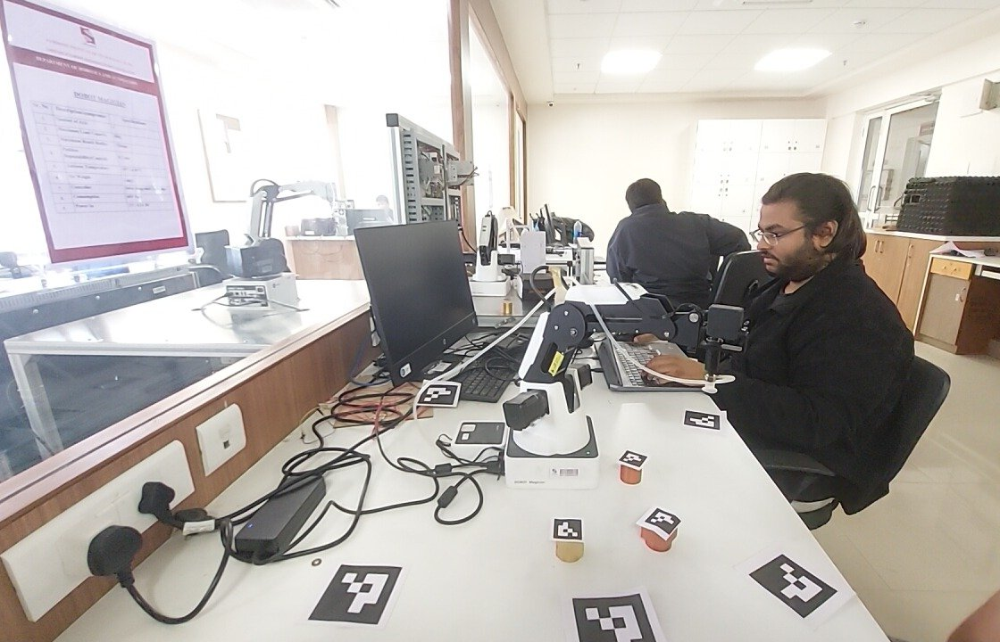 <b>Bench setup</b> · Dobot Magician, ArUco markers, test objects</td>
    <td width="50%" align="center">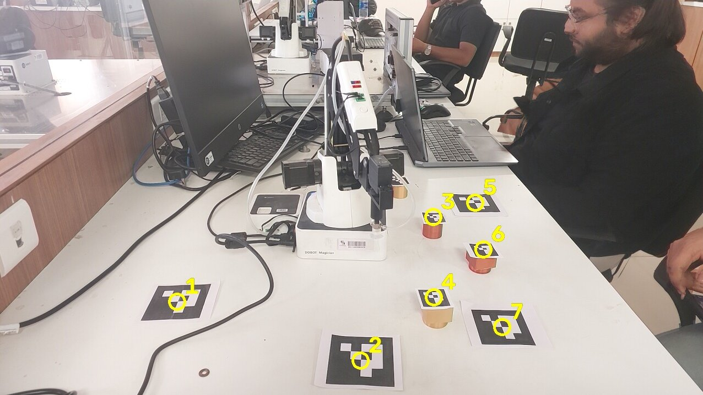 <b>Calibration</b> · numbered ArUco markers link camera pixels to robot coordinates</td>
  </tr>
</table>

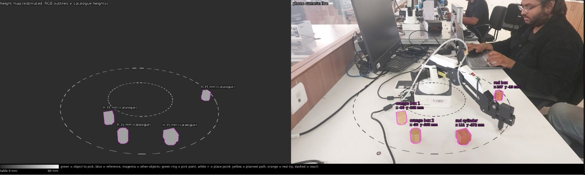 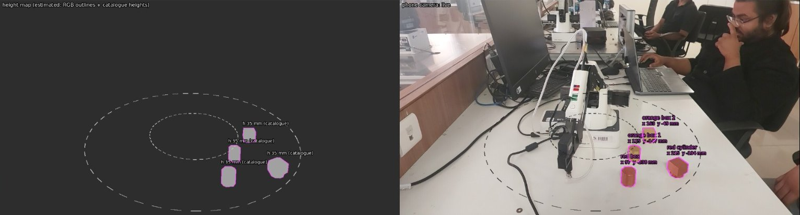 <b>Live detection</b> · height map (left) and camera view (right): each object is labelled with its x / y in mm and checked against the dashed reach rings. The second frame shows a rearranged scene.

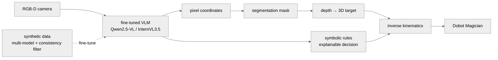

#### Vision-Based Target Tracking with LiDAR Collision Avoidance (ROS 2)
<code>Python · ROS 2 Humble · Gazebo · TurtleBot3 · OpenCV</code> · [**repo →**](https://github.com/Fe3w/Pepermint_task1_abhishek)

A two-node ROS 2 package: HSV segmentation and contour centroids feed a proportional visual-servoing controller; the robot spins to reacquire a lost target, and a LiDAR check (0.5 m in a 20° frontal cone) stops it before a collision. All gains and thresholds are ROS 2 parameters, with a one-command launch file.

**Target search, acquisition and pursuit** · the TurtleBot3 rotates in place to locate the target, then follows it using proportional visual servoing on the image-centre error.

https://github.com/user-attachments/assets/8b71ba75-8a89-4cfd-ae5a-b8ca14dbee04

**LiDAR-based collision avoidance** · as the robot closes in, the frontal-cone range check commands zero velocity before contact.

https://github.com/user-attachments/assets/fcea9351-c6b0-4003-a7d3-23be096ce114

---

### `06 — MORE BUILDS & LEADERSHIP`

#### EMG + Computer-Vision Robotic Hand
3D-printed hand driven by EMG input and a real-time OpenCV/MediaPipe gesture tracker; commands stream over MQTT to an ESP32 with **<100 ms** actuator response. I wrote the ESP32 subscriber firmware and made CAD changes for mechanical alignment.

https://github.com/user-attachments/assets/1f63cb8e-624d-42df-a676-d73537d68324

#### Team Robominds · DD Robocon 2026 — Design Lead & Co-Head
Jan – Jun 2026

Led a **30-member** cross-functional team through rapid design iterations: **90/100** in the preliminary round and a place in the **National Finals (Stage 3) at IIT Delhi**. Owned planning and technical decisions on component selection, structural load analysis and actuation design under strict weight and geometry limits, following a V-Model lifecycle. [Event update on LinkedIn →](https://www.linkedin.com/posts/abhishek-singh-a2003b287_robocon2026-teamrobominds-automation-ugcPost-7438862846412771328-uZSR)

https://github.com/user-attachments/assets/18fe45f4-467c-4aaa-97d2-063ad31eb409

#### Drone CAD for Robofest
Drone assembly in Siemens NX, focused on packaging, structural layout and balance.

<table>
  <tr>
    <td width="50%"></td>
    <td width="50%"></td>
  </tr>
</table>

<b>Python tooling</b>

 

- OCR-based PDF retrieval (PyMuPDF, pytesseract): scans nested folders, falls back to OCR on scanned pages, finds PDFs by keyword
- Face-similarity search integrated with the Google Drive API (OAuth)
- Automated image-dataset preprocessing and splitting for CNN training
- Scripted Gazebo simulation runs; used the data to fine-tune bipedal robot control models

<b>Education, coursework & certifications</b>

 

- **B.Tech, Robotics & Automation Engineering** · Honors in Embedded & Automotive Systems · Symbiosis Institute of Technology, Pune · CGPA 7.65 · expected June 2027
- **Independent study:** Cornell CS 6120 Advanced Compilers (LLVM IR, analysis, optimization) · MIT 6.S894 Accelerated Computing (GPU programming, CUDA)
- **Advanced VLSI Design** (Compcarta): SystemVerilog, digital design, testing
- **NPTEL:** Deep Learning for Computer Vision (IIT Hyderabad) · Advanced Robotics (IIT Kanpur)
- **MathWorks:** MATLAB, Simulink, Stateflow Onramps

---

### `07 — CONTACT`

**Working on compilers, GPU performance or autonomous systems that need to run faster? Say hello.**

[Email](mailto:abhishekp135531@gmail.com) · [LinkedIn](https://www.linkedin.com/in/abhishek-singh-a2003b287/) · [GitHub](https://github.com/Fe3w) · [LeetCode](https://leetcode.com/u/Abhishek_P_S_/) · [X](https://x.com/Fe3ws_)

`COMPILERS · GPU PERFORMANCE · AUTONOMOUS SYSTEMS` · Pune, Maharashtra, IN

 

<a href="https://x.com/Ki11_5trike" title="Umbrella art by @Ki11_5trike">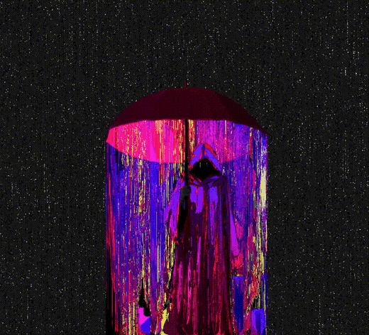</a>

Hourglass and umbrella art by <a href="https://x.com/Ki11_5trike"><b>@Ki11_5trike</b></a>

