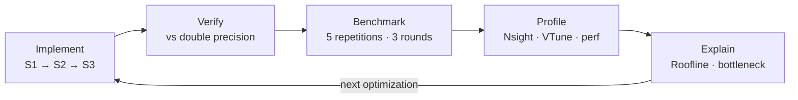

<div align="center">


RACE_VIDEO_URL


# CPU vs GPU: Performance Profiling and Optimization

### Making AI and scientific code **up to 114× faster** on a laptop, and proving *why*


</div>

**CPU vs GPU race** · every version of each task races on one shared clock. The race ends when the slowest version (the simple CPU code) finishes once. Longer bars mean faster code, drawn to true scale. The race slows to ¼ speed halfway through so you can see the differences.

- **Vector add:** the GPU is about **45×** faster than the simple CPU code. Better GPU code doesn't help, because memory speed is the limit.
- **Dot product:** smarter GPU code makes it **34.5×** faster, and about **50×** faster than the simple CPU code.
- **Matrix multiply:** optimising the CPU code makes it **114×** faster. The GPU's Tensor Cores go further: about **6,200×** faster than the simple CPU code and **55×** faster than the best CPU code.
- **Attention:** fusing the steps into one kernel, then using FP16 Tensor Cores, makes the GPU **50×** faster than its own simple version, and about **1,850×** faster than the simple CPU code.

## Watch the 72-second story

https://github.com/user-attachments/assets/09a2eef4-9177-4cbb-a606-08fad9ee938b

<sub>Every workload, animated from the measured data. If the player doesn't load: <a href="https://github.com/user-attachments/assets/09a2eef4-9177-4cbb-a606-08fad9ee938b">open the video</a>.</sub>

<p align="center">
  
</p>

<div align="center">

| **50×** | **114×** | **34.5×** | **34 / 34** |
|:---:|:---:|:---:|:---:|
| faster AI attention<br>on the GPU | faster matrix multiply<br>on the CPU | from one change to how<br>partial results are combined | results verified against<br>a double-precision reference |

</div>

## In plain words

- **Same answer, far less waiting.** The attention operation inside large language models (LLMs) ran **32 ms → 0.64 ms** for one 8-head layer after optimization.
- **Far less memory.** At 8,192 tokens, the simple attention needs **2,112 MiB** of GPU memory; the optimized one needs **64 MiB**, **33× less**. Less memory per layer is what lets models read longer documents.
- **Knowing when to stop.** Vector add was already at **88% of the memory-bandwidth limit**, so no code change could make it faster. Measuring that first saves engineering time.
- **Every speedup is explained**, not just measured: hardware profilers show *which* limit each version hits.

---

## The four workloads

Each workload is written **three times**, from the simplest correct code to code that uses special hardware, on **both** a CPU and a GPU.

| Workload | What it computes | **Where you meet it** | What limits it |
|---|---|---|---|
| **W01 · Vector Add** | `C = A + B` on 33.5 M numbers | element-wise maths: image blending, the residual add in neural networks | **memory bandwidth** |
| **W02 · Dot Product** | `s = Σ aᵢbᵢ` on 33.5 M numbers | similarity scores in **search and recommendation** systems | **how partial sums are combined** |
| **W03 · Matrix Multiply** | `C = A × B`, 1024 × 1024 | **most of the compute in every neural network**, scientific simulation | **arithmetic and data reuse** |
| **W04 · Attention** | `softmax(QKᵀ/√d)·V`, 2,048 tokens, 8 heads | the core operation of **large language models (Transformers)** | **memory traffic**, until fused |

**Every version climbs the same three-step ladder:**

| Stage | Idea | CPU | GPU |
|---|---|---|---|
| **S1 · Baseline** | simplest correct code | one thread, plain loops | one thread per output |
| **S2 · Software** | better algorithm, parallelism | OpenMP threads, cache blocking, fusion | coalescing, shared-memory tiles, block reductions, **kernel fusion** |
| **S3 · Hardware** | special units | **AVX2 / FMA** vector instructions | **TF32 / FP16 Tensor Cores** |

---

## Key results

<p align="center">
  
</p>

| Workload | Device | Simple → best | **Speedup** | **Why** |
|---|---|---|:---:|---|
| **W01** Vector Add | GPU | 1.80 → 1.80 ms | **1.0×** | Already streams **224 GB/s** (88% of peak): memory-bound |
| | CPU | 79.9 → 7.77 ms | **10.3×** | All from threads; 6 threads already saturate memory |
| **W02** Dot Product | GPU | 43.4 → 1.26 ms | **34.5×** | One shared counter serialized every thread; **block reduction** fixes it |
| | CPU | 63.4 → 3.96 ms | **16.0×** | Threads 13.2×, then 8-wide FMA 1.21× |
| **W03** Matrix Multiply | GPU | 2.46 → 0.472 ms | **5.2×** | Shared-memory tiles 1.36×, then **Tensor Cores 3.8×** |
| | CPU | 2,932 → 25.7 ms | **114×** | **Cache blocking + threads 32.9×**, then 8-wide FMA 3.5× |
| **W04** Attention | GPU | 32.1 → 0.640 ms | **50.1×** | Better kernels 3.38× · **fusion** 3.15× · **FP16 Tensor Cores** 4.70× |
| | CPU | 1,188 → 12.9 ms | **92.1×** | Fusion + blocking + threads 31.5×, then AVX2 with a vectorized `exp` 2.93× |

**Best GPU vs best CPU:** **4.3×** (W01) · **3.1×** (W02) · **54.5×** (W03) · **20.1×** (W04).

**The pattern:**

- **Memory-bound work** (W01, W02): the GPU wins by about its bandwidth advantage, **3–4×**. Beyond that, only moving fewer bytes helps.
- **Compute-bound work** (W03, W04): the GPU wins by **20–55×**, once the code reuses data on chip and uses Tensor Cores.
- **Fusion changes the problem.** Fusing W04 cut DRAM traffic **24–31×**, turning a memory-bound operation into a compute-bound one. This is the idea behind **FlashAttention**, now standard in deep-learning frameworks.

<sub>One session, run `20261106-151143`: 2 warm-ups, 20 timed iterations, 5 repetitions; GPU stages median of 3 rounds. Laptop at its default 55 W power limit. Full tables and method: [`docs/RESULTS_SUMMARY.md`](docs/RESULTS_SUMMARY.md).</sub>

---

## Why it's fast: the Roofline

<p align="center">
  
</p>

A Roofline shows the **two limits** every kernel faces. The **diagonal** is memory bandwidth (256 GB/s). The **flat lines** are peak compute (16.4 TFLOP/s for FP32/TF32, 32.8 for FP16 Tensor Cores). A kernel can't go above the lower of the two at its **operational intensity**, the FLOPs it does per byte it moves.

- **W01 and W02 sit on the diagonal** at **84–88%** of the bandwidth roof: memory-bound, close to the limit.
- **Unfused attention** (S1, S2a, cuBLAS) sits at **~15 FLOP/byte**, deep in memory-bound territory, because a huge score table goes through DRAM.
- **Fusion moves W04 right**, to **363 FLOP/byte**; **Tensor Cores move it up**, to **13.3 TFLOP/s**.
- **Room left:** the Tensor Core kernels reach **28–46%** of their compute roof; tuned libraries go further with larger register tiles and asynchronous copies.

<sub>W04 points use DRAM bytes measured with Nsight Compute; W01–W03 use algorithmic bytes. Compute roofs from the Ada whitepaper at the measured 2,670 MHz clock. Every value: [`figure_values.csv`](docs/figures/readme/figure_values.csv).</sub>

<details>
<summary><b>W04 deep dive: where the 50× comes from, and how it scales with sequence length</b></summary>
<br>

<p align="center"></p>

**50.1× = 3.38× (better kernels) × 3.15× (fusion + register tiling) × 4.70× (FP16 Tensor Cores).**

<p align="center"></p>
<p align="center"></p>

- The fused FP32 kernel (3.01 ms) beats a **cuBLAS-based** unfused reference (3.35 ms) by **1.11×**.
- Unfused memory grows with the **square** of the sequence length; fused memory grows **linearly** (144 MiB vs 16 MiB at 2,048 tokens).
- FP16 Tensor Cores add only **0.03%** error against double precision.

Full development log: [`docs/results/W04_phase_results.md`](docs/results/W04_phase_results.md).

</details>

---

## How the results were produced



- **Correctness first:** a version counts only if it matches the double-precision reference within tolerance.
- **Benchmarks measure, profilers explain:** profiler timings are never used as speedups.
- **Same session only:** every compared number comes from one run on one machine.

## Skills demonstrated

| Area | What was done |
|---|---|
| **GPU programming** | CUDA kernels from scratch: coalescing, shared-memory tiling, warp shuffles, block reductions, **FlashAttention-style fusion**, **WMMA Tensor Cores** (TF32 and FP16) |
| **CPU optimization** | OpenMP threading, cache blocking, **AVX2/FMA intrinsics**, a vectorized `exp`, compiler-flag studies |
| **Performance analysis** | **Nsight Compute** (DRAM bytes, stalls, occupancy), **Nsight Systems**, **Intel VTune**, `perf`, SASS inspection, **Roofline modelling** |
| **Engineering rigour** | double-precision verification, paired repeated measurements, autotuning, reproducible scripts, a live demo kit |

---

## Get the project

```bash
git clone https://github.com/Fe3w/GPU-CPU-Performance-Profiling_and-Optimization.git
cd GPU-CPU-Performance-Profiling_and-Optimization
make legacy w04 && bash tests/test_w04_correctness.sh
```

**→ [Setup, reproduction and live-demo guide](docs/GUIDE.md)**

<sub>Further reading: [results summary](docs/RESULTS_SUMMARY.md) · [complete brief](Comparison%20final/Complete%20Brief.md) · [W04 design plan](docs/W04_Attention_Plan.md) · References: Williams et al., *Roofline*, CACM 2009 · Dao et al., *FlashAttention*, NeurIPS 2022 · Boehm, *How to Optimize a CUDA Matmul Kernel*.</sub>
