<!--
  Style: black, white and greys; square frames; Inter + DejaVu Sans Mono.
  Graphics: python tools/make_mono.py (banner, stack)
            python tools/make_results_png.py (GPU-project result charts)
  Videos: a bare https://github.com/user-attachments/assets/<id> URL on its own
  line (blank line above and below) renders as GitHub's video player.
-->

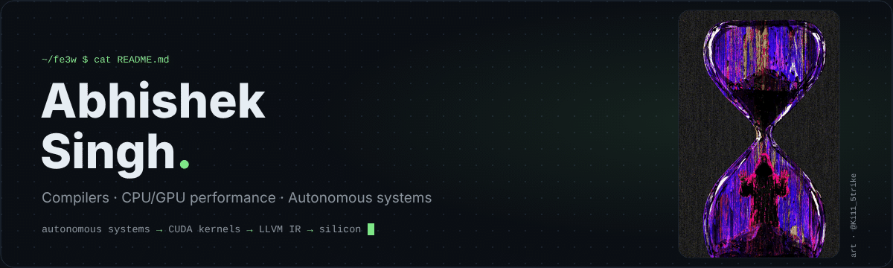

  <a href="#whoami"><code>01 WHOAMI</code></a> ·
  <a href="#stack"><code>02 STACK</code></a> ·
  <a href="#performance"><code>03 PERFORMANCE</code></a> ·
  <a href="#compilers"><code>04 COMPILERS</code></a> ·
  <a href="#autonomy"><code>05 AUTONOMY</code></a> ·
  <a href="#builds"><code>06 BUILDS</code></a> ·
  <a href="#contact"><code>07 CONTACT</code></a>

Pune, IN · B.Tech, class of 2027 · Honors in Embedded Systems · DD Robocon 2026 National Finalist · open to compiler and performance internships

---

### `01 — WHOAMI`

Final-year Robotics & Automation student (Honors in Embedded Systems) at Symbiosis Institute of Technology, Pune, **working my way down the stack**. I started with autonomous systems that perceive, decide and act. Now most of my time goes to what sits underneath them: the kernels, the compilers and the hardware that decide how fast any of it runs.

- **Currently building:** an LLVM loop-analysis pass, a C-like compiler with an LLVM IR backend, and an ML-workload extension to my roofline study
- **Looking for:** internships in compiler optimization, CPU/GPU performance engineering, systems software and accelerated computing
- **Ask me about:** roofline models, why a GEMM is memory-bound until it isn't, LLVM's new pass manager, perception-to-control pipelines in ROS 2
- **Off-keyboard:** led design for Team Robominds to the DD Robocon 2026 National Finals at IIT Delhi

---

### `02 — STACK`

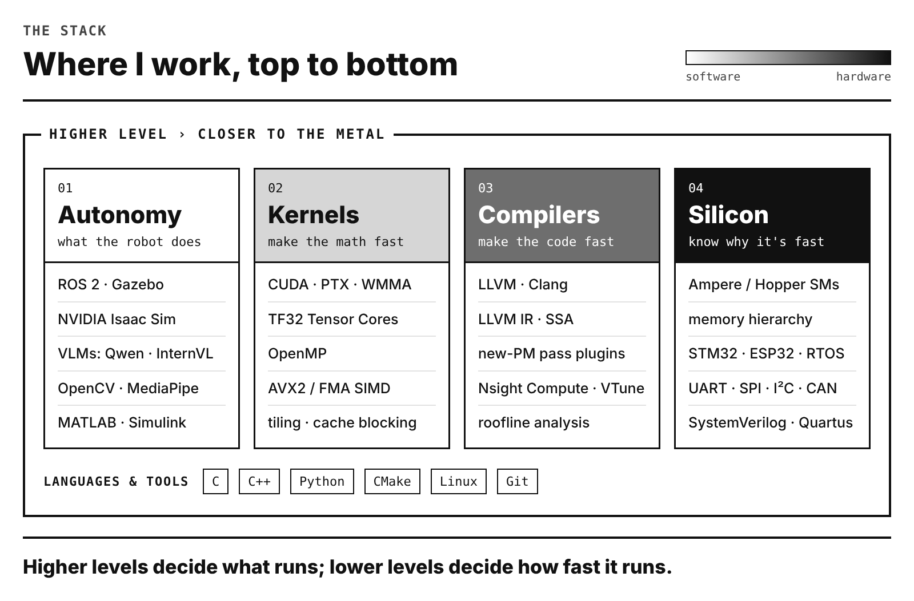

<b>Full skills list</b> (text)

 

| Compilers & performance | Parallel & GPU | Autonomy & embedded | ML & vision |
|---|---|---|---|
| LLVM / Clang · LLVM IR | CUDA · PTX · WMMA | ROS 2 (Humble / Jazzy) · Gazebo | Qwen2.5-VL · InternVL3.5 fine-tuning |
| New-pass-manager plugins | OpenMP · AVX2 / FMA | NVIDIA Isaac Sim · Dobot Magician | Synthetic data pipelines |
| Roofline · arithmetic intensity | TF32 Tensor Cores | STM32 · ESP32 · RTOS concepts | OpenCV · MediaPipe |
| Nsight Compute · Intel VTune | Cache blocking · shared-memory tiling | UART / SPI / I²C / CAN · MQTT | Keras · NumPy · Pandas |
| GCC · micro-benchmarking | Ampere / Hopper SM architecture | MATLAB · Simulink · Stateflow | SystemVerilog · Intel Quartus |

---

### `03 — PERFORMANCE ENGINEERING`

#### Heterogeneous CPU/GPU Performance Analysis & Roofline Profiling
<code>Honors project · 2026</code> · core benchmarks done · ML-workload extension in progress · <code>C++ · OpenMP · AVX2/FMA · CUDA · WMMA · VTune · Nsight Compute</code>

[**Project report**](https://drive.google.com/file/d/1XhWOYI6mYyLRbKIm25UFTFQibAgZOgr0/view?usp=sharing) · [**Seminar paper**](https://drive.google.com/file/d/1Iqg1ht8dw_D7Ud5cnDXnYjy3pSv4l__W/view?usp=sharing)

How far are textbook kernels from what the hardware can actually do, and *why*? I benchmarked baseline kernels on an **Intel Core i7-13650HX** and an **NVIDIA RTX 4060 Laptop GPU**, optimized them step by step, and used profiling plus Roofline analysis to explain each gap: memory bandwidth, core utilization, register pressure, occupancy.

| Kernel | Arithmetic intensity | CPU speedup | GPU speedup | What limits the GPU (Nsight Compute) |
|---|---|---|---|---|
| Vector add | 0.083 FLOP/byte | **12.7×** | **1.0×** | DRAM 92% busy → memory-bound |
| Dot product | 0.25 FLOP/byte | **13.3×** | **28.7×** | tree reduction removes the serial chain |
| GEMM | 170.7 FLOP/byte | **121.6×** · 0.707 → 86.03 GFLOP/s | **3.7×** · 730 → 2,679 GFLOP/s | naive: SM 99% (FP32 pipe) · Tensor Cores: starved of data |

CPU: cache blocking · OpenMP · AVX2/FMA. GPU: coalescing · block reduction · shared-memory tiling · TF32 WMMA Tensor Cores. Every output validated against a reference implementation · TF32 GEMM max relative error <b>0.0686%</b>.

<table>
  <tr>
    <td width="33%" valign="top"><a href="assets/media/results-speedup.png">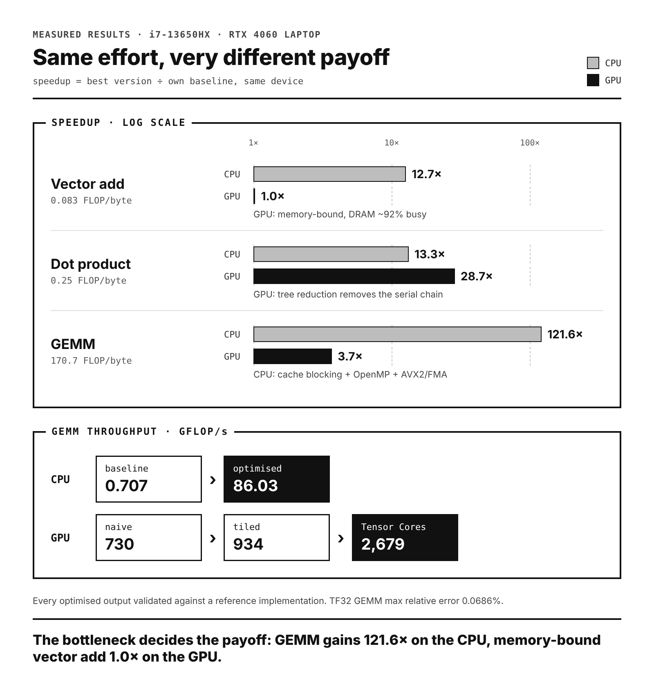</a> <b>Results</b> · speedup per kernel</td>
    <td width="33%" valign="top"><a href="assets/media/results-profiler.png">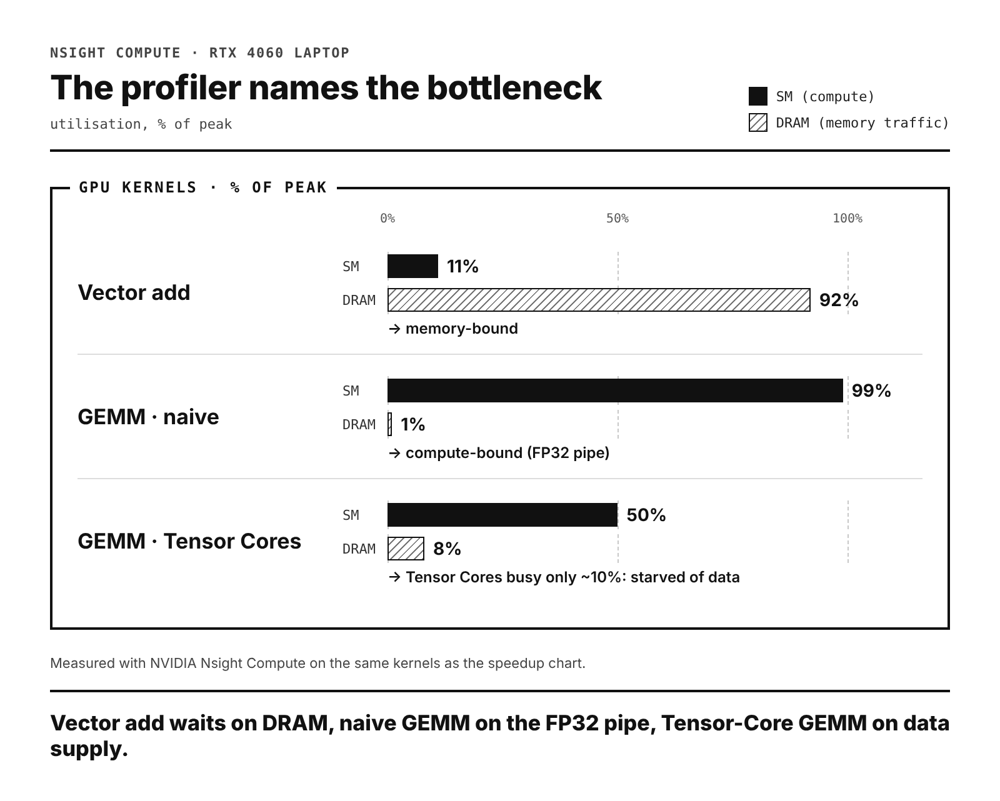</a> <b>Results</b> · profiler bottlenecks</td>
    <td width="33%" valign="top"><a href="assets/media/arch-cpu-vs-gpu.png">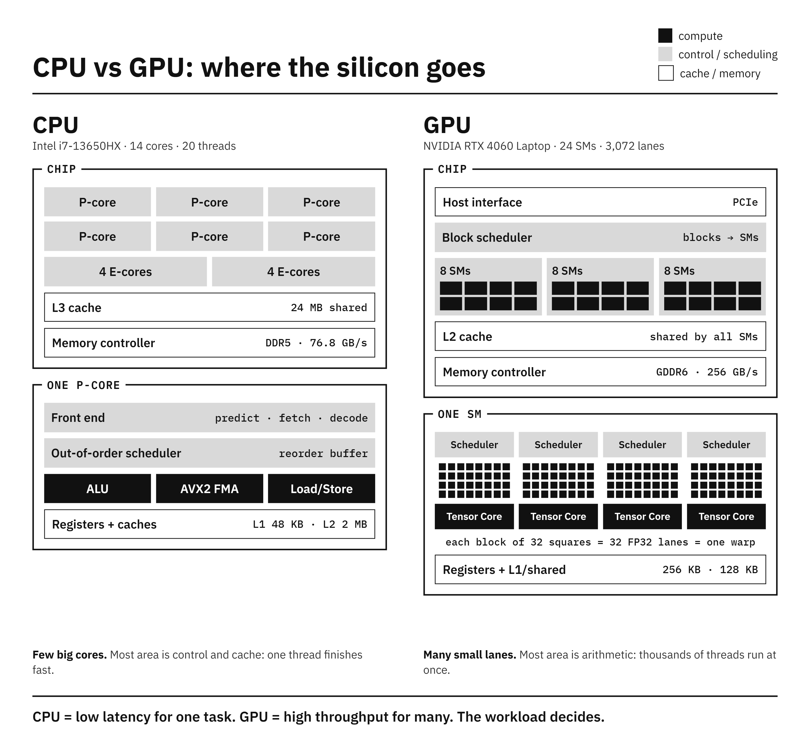</a> <b>Architecture</b> · where the silicon goes</td>
  </tr>
  <tr>
    <td width="33%" valign="top"><a href="assets/media/arch-work-flow.png">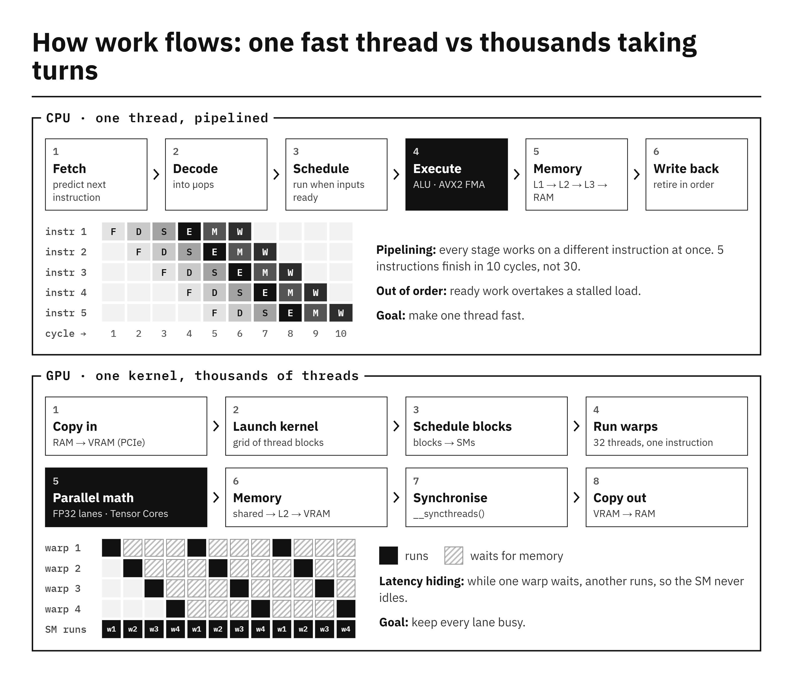</a> <b>Architecture</b> · how work flows</td>
    <td width="67%" valign="top" colspan="2"><a href="assets/media/arch-memory-hierarchy.png">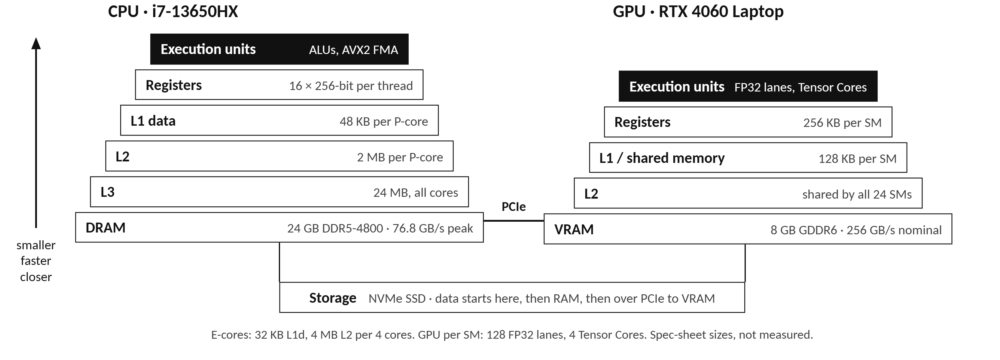</a> <b>Architecture</b> · memory hierarchy</td>
  </tr>
</table>

Click any chart or diagram to open it full size.

**CPU vs GPU, explained with my measurements** · a 103-second walkthrough: where the silicon goes, how work flows through each processor, the memory hierarchy, the optimisation techniques, the measured results and which workloads suit which processor.

https://github.com/user-attachments/assets/b8438f65-99d4-4611-a12c-56aaf073b32a

**Real-time race on the GPU** · every kernel version runs against one shared clock until the slowest (the dot-product baseline) has finished three times; playback is slowed so the race is visible. In this run, block reduction takes the dot product from 227.48 ms to 6.50 ms (**34.98×**), GEMM goes 14.55 → 9.98 → 3.85 ms (tiled **1.46×**, TF32 Tensor Cores **3.78×**, 2,987 GFLOP/s), and coalescing leaves the memory-bound vector add unchanged (0.99×).

https://github.com/user-attachments/assets/59c39e98-2050-4bd9-8ce8-9170273fc229

A separate run from the report table above, so the figures differ slightly.

**Next:** extending the study to ML workloads (in progress).

#### Seminar paper · Breaking the Compute Bottleneck
<code>Honors seminar · 2026</code> · [**Read the paper**](https://drive.google.com/file/d/1Iqg1ht8dw_D7Ud5cnDXnYjy3pSv4l__W/view?usp=sharing)

How CPU, GPU and TPU/NPU architectures evolved for deep learning, and how the compiler stack (LLVM IR, MLIR, SSA, control-flow graphs, alias and dependence analysis) shapes code generation, loop transformations, fusion and vectorization. Applies Roofline analysis to published NVIDIA A100 GEMM results.

---

### `04 — COMPILERS` in progress

Building the compiler side from both ends: a tool that **reads** optimized IR, and a compiler that **writes** it.

| Project | What it does | Stack |
|---|---|---|
| **LLVM Loop Optimization Advisor** | Analysis-only new-pass-manager plugin that reports loop structure, memory accesses and control-flow properties, without modifying the IR. Regression tests cover nested loops, reductions, unknown trip counts and dependent accesses. | C++ · LLVM · CMake |
| **Mini C-like compiler** | Lexer → parser → AST → semantic checks → LLVM IR for arithmetic, `if/else` and `while`, then the LLVM verifier, optimization passes and native codegen. | C++ · LLVM |

---

### `05 — AUTONOMOUS SYSTEMS`

#### Neuro-Symbolic Autonomous Sorting · VLM pipeline
<code>B.Tech project · 2026</code> · in progress · <code>Python · Isaac Sim · Dobot Magician · Qwen2.5-VL · InternVL3.5</code>

A vision-language-guided sorting system for autonomous manipulation that turns *"put the red parts in the left bin"* into arm motion, and explains each decision. Model predictions become segmentation masks, depth turns them into 3D targets, rule-based symbolic logic makes the sort decision, and inverse kinematics drives a Dobot Magician. Each task is validated in NVIDIA Isaac Sim, then run on the physical arm. To cut API dependence and latency, I'm fine-tuning smaller open-weight VLMs on synthetic data filtered for consistency.

**Simulation: language-conditioned pick-and-place in NVIDIA Isaac Sim** · task: *"pick up the green cube and place it next to the cylinder"*. The VLM interprets the scene, the planner avoids the remaining objects, and the arm executes the placement.

https://github.com/user-attachments/assets/113927a2-1523-44bc-97b1-f1e8f54ed114

**On the real Dobot Magician** · phone camera, ArUco markers that map pixels to the robot frame, and live object detection with pick coordinates in mm, checked against the arm's reach envelope

<table>
  <tr>
    <td width="50%" align="center">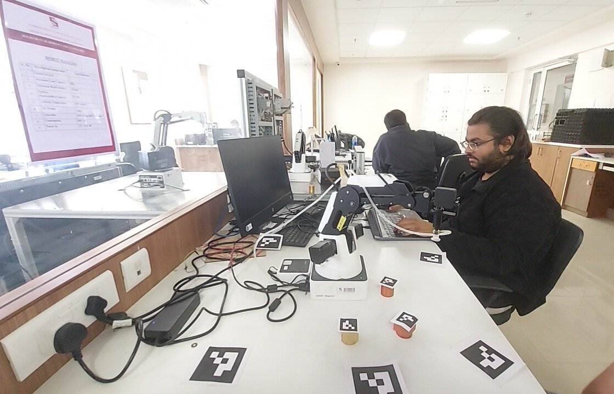 <b>Bench setup</b> · Dobot Magician, ArUco markers, test objects</td>
    <td width="50%" align="center">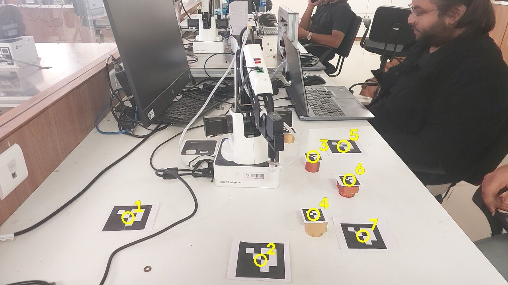 <b>Calibration</b> · numbered ArUco markers link camera pixels to robot coordinates</td>
  </tr>
</table>

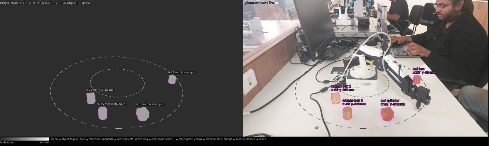 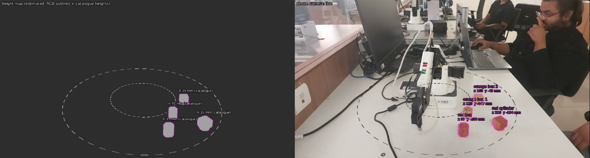 <b>Live detection</b> · height map (left) and camera view (right): each object is labelled with its x / y in mm and checked against the dashed reach rings. The second frame shows a rearranged scene.

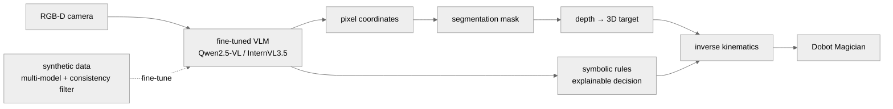

#### Vision-Based Target Tracking with LiDAR Collision Avoidance (ROS 2)
<code>Python · ROS 2 Humble · Gazebo · TurtleBot3 · OpenCV</code> · [**repo →**](https://github.com/Fe3w/Pepermint_task1_abhishek)

A two-node ROS 2 package: HSV segmentation and contour centroids feed a proportional visual-servoing controller; the robot spins to reacquire a lost target, and a LiDAR check (0.5 m in a 20° frontal cone) stops it before a collision. All gains and thresholds are ROS 2 parameters, with a one-command launch file.

**Target search, acquisition and pursuit** · the TurtleBot3 rotates in place to locate the target, then follows it using proportional visual servoing on the image-centre error.

https://github.com/user-attachments/assets/8b71ba75-8a89-4cfd-ae5a-b8ca14dbee04

**LiDAR-based collision avoidance** · as the robot closes in, the frontal-cone range check commands zero velocity before contact.

https://github.com/user-attachments/assets/fcea9351-c6b0-4003-a7d3-23be096ce114

---

### `06 — MORE BUILDS & LEADERSHIP`

#### EMG + Computer-Vision Robotic Hand
3D-printed hand driven by EMG input and a real-time OpenCV/MediaPipe gesture tracker; commands stream over MQTT to an ESP32 with **<100 ms** actuator response. I wrote the ESP32 subscriber firmware and made CAD changes for mechanical alignment.

https://github.com/user-attachments/assets/1f63cb8e-624d-42df-a676-d73537d68324

#### Team Robominds · DD Robocon 2026 — Design Lead & Co-Head
Jan – Jun 2026

Led a **30-member** cross-functional team through rapid design iterations: **90/100** in the preliminary round and a place in the **National Finals (Stage 3) at IIT Delhi**. Owned planning and technical decisions on component selection, structural load analysis and actuation design under strict weight and geometry limits, following a V-Model lifecycle. [Event update on LinkedIn →](https://www.linkedin.com/posts/abhishek-singh-a2003b287_robocon2026-teamrobominds-automation-ugcPost-7438862846412771328-uZSR)

https://github.com/user-attachments/assets/18fe45f4-467c-4aaa-97d2-063ad31eb409

#### Drone CAD for Robofest
Drone assembly in Siemens NX, focused on packaging, structural layout and balance.

<table>
  <tr>
    <td width="50%"></td>
    <td width="50%"></td>
  </tr>
</table>

<b>Python tooling</b>

 

- OCR-based PDF retrieval (PyMuPDF, pytesseract): scans nested folders, falls back to OCR on scanned pages, finds PDFs by keyword
- Face-similarity search integrated with the Google Drive API (OAuth)
- Automated image-dataset preprocessing and splitting for CNN training
- Scripted Gazebo simulation runs; used the data to fine-tune bipedal robot control models

<b>Education, coursework & certifications</b>

 

- **B.Tech, Robotics & Automation Engineering** · Honors in Embedded & Automotive Systems · Symbiosis Institute of Technology, Pune · CGPA 7.65 · expected June 2027
- **Independent study:** Cornell CS 6120 Advanced Compilers (LLVM IR, analysis, optimization) · MIT 6.S894 Accelerated Computing (GPU programming, CUDA)
- **Advanced VLSI Design** (Compcarta): SystemVerilog, digital design, testing
- **NPTEL:** Deep Learning for Computer Vision (IIT Hyderabad) · Advanced Robotics (IIT Kanpur)
- **MathWorks:** MATLAB, Simulink, Stateflow Onramps

---

### `07 — CONTACT`

**Working on compilers, GPU performance or autonomous systems that need to run faster? Say hello.**

[Email](mailto:abhishekp135531@gmail.com) · [LinkedIn](https://www.linkedin.com/in/abhishek-singh-a2003b287/) · [GitHub](https://github.com/Fe3w) · [LeetCode](https://leetcode.com/u/Abhishek_P_S_/) · [X](https://x.com/Fe3ws_)

`COMPILERS · GPU PERFORMANCE · AUTONOMOUS SYSTEMS` · Pune, Maharashtra, IN

 

<a href="https://x.com/Ki11_5trike" title="Umbrella art by @Ki11_5trike">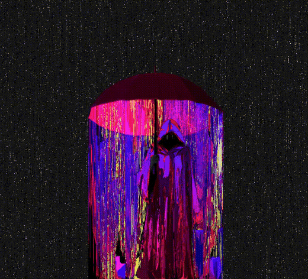</a>

Hourglass and umbrella art by <a href="https://x.com/Ki11_5trike"><b>@Ki11_5trike</b></a>

